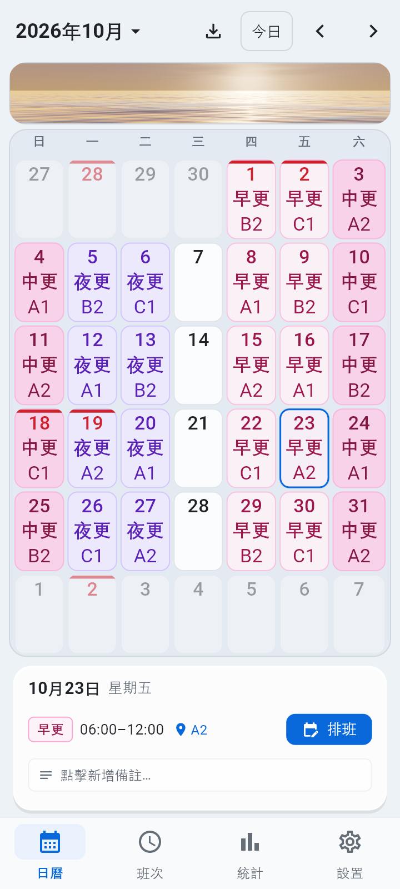
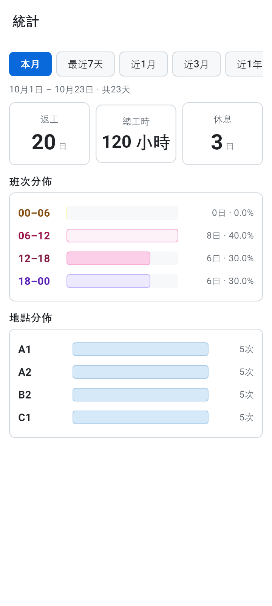
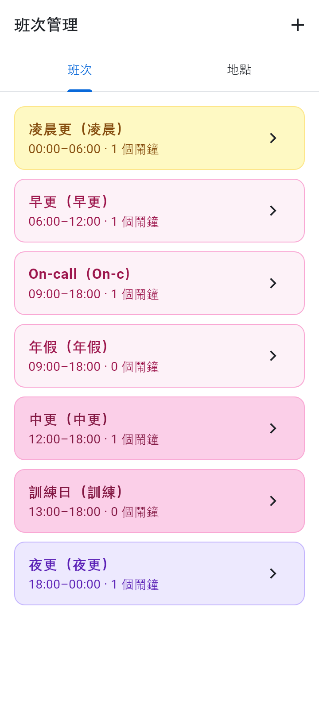

# ShiftAlarm 排班鬧鐘 ⏰

[](https://flutter.dev)
[-3DDC84?logo=android&logoColor=white)](https://windowmmk.github.io/ShiftAlarm/)
[](https://github.com/windowmmk/ShiftAlarm)
[](LICENSE)
[](https://github.com/windowmmk/ShiftAlarm/releases)
[](https://github.com/windowmmk/ShiftAlarm/actions/workflows/deploy-web.yml)

專為輪班與排班人士打造的**極致隱私、純離線**排班日曆與精確鬧鐘（Flutter / Android 原生整合 / Web PWA）。

🌐 **線上體驗 Web 版**：[https://windowmmk.github.io/ShiftAlarm/](https://windowmmk.github.io/ShiftAlarm/)

<p align="center">
  
  &nbsp;&nbsp;
  
  &nbsp;&nbsp;
  
</p>

<p align="center">
  <sub>日曆主畫面（天色帶／月曆／排班詳情）　·　工時統計　·　班次管理</sub>
</p>

> 以上為**真實 UI 截圖**，由 `tool/gen_screenshots_test.dart` 經 Flutter 渲染管線直接輸出，非設計稿或合成圖。

---

## 🔒 核心承諾：極致隱私與純離線

- **100% 離線**：Android 層級**完全未申請 `INTERNET` 權限**，在物理層面杜絕聯網可能。
- **無帳號、無雲端**：班次、排程與備註全數存放本機，永不離開裝置。
- **零追蹤、零廣告**：無 Firebase、無 Crashlytics、無任何第三方追蹤分析或廣告 SDK。
- **開源可審計**：全開源，程式碼乾淨透明，隨時接受社群審查。

---

## ✨ 功能一覽

### 🖥️ 三區固定版面（v3.6 起）

頂部天色帶／中間月曆／底部排班詳情，**三區高度比例固定，不再彈出彈入**；可用高度不足時天色帶讓位（96px → 下限 56px），輸入文字（場名／備註）鍵盤彈起時**完全壓縮為 0**，把空間全讓給日曆。

### 🌊 天色帶與四時天空

- Android 與 Web **共用同一套 fragment shader**（`shaders/ocean.frag`），真光影：9 層傅立葉物理波高、次表面散射、太陽碎鑽光斑、星夜藍眼淚。
- 依時辰自動切換四時天色：🌅 晨曦破曉（05:00–10:59）、☀️ 豔陽碧海（11:00–16:29）、🌇 金暉落日（16:30–21:29）、🌌 星夜深邃（21:30–04:59）。未選日期時按目前實際時鐘呈現。
- v3.6.3 起天色帶與月曆卡**共用同一底色、描邊、圓角與內縮**，闊屏（> 480px）亦不會錯位。

### 📅 月曆

- **標準 42 格固定網格**（每月 6 行），消除跨月高度撕裂；日曆格理想高度 75px。
- 點選震動回饋、年月快速跳轉面板、**澳門公眾假期標註**、每日常駐便利貼。
- Web 端 60fps：`RepaintBoundary` 隔離重繪與文字佈局快取。

### ⏰ 精準輪班鬧鐘（Android 原生）

- 每班次最多 10 組鬧鐘；原生 `AlarmManager` 精確調度，鎖屏全屏喚醒（前台服務＋系統鬧鐘鈴聲）。
- **響前 1 小時倒計時預告**：以狀態欄倒計時呈現（非推播），**只限真鬧鐘**——純通知類（打卡）不發預告；響鬧即撤下，重開機由 `BootReceiver` 重建。
- 溫和通知模式（僅通知、輕震動）；開機自動重排所有未來鬧鐘。
- 內建精確鬧鐘、全屏通知、電池最佳化白名單**權限自檢儀表板**。

### 🔗 分享與導入（SA2 / SR2 極簡二進制協議）

- **體積壓縮 90%+**：配置口令 `SA2:<Base58>` 壓至 90–115 字元，整月排班 `SR2:<Base58>` 壓至 150–230 字元。
- **CRC32 防偽校驗**：IEEE 802.3 CRC32 與 UNIX 時間戳內嵌於二進制前導區，防截斷與竄改。
- 網址一鍵導入（`?c=SA2:...`／`?r=SR2:...`，微信友善無 `#`）、剪貼簿即時探針、面對面 QR Code 快傳。
- 雙模相容純 CSV 文字（`YYYY-MM-DD,班次代號,地點`），Excel／記事本可直接編輯。

### 📊 統計與班次管理

- 多維區間統計（本月／近 7／30／90 天／今年至今／自訂）、班次比例與地點分佈圖表。
- **總工時按實際班次長度**逐筆計算，支援跨午夜班次，顯示「X 小時 Y 分」。
- 班次編輯器內建**日曆格即時預覽**（所見即所得，字級已鎖定、唔受系統字體縮放影響）；地點輸入自動補全歷史記錄。

---

## 📂 專案結構

```text
ShiftAlarm/
├── android/               # Android 原生模組（AlarmScheduler/Receiver、BootReceiver、
│                          #   AlarmActivity 全屏喚醒、PreAlert 響前預告、AlarmIdRegistry）
├── lib/
│   ├── alarm/             # MethodChannel 橋接層（shift_alarm/alarm）
│   ├── domain/            # 純 Dart 領域層：SA2/SR2 編解碼、Base58、CSV、假期、
│   │                      #   統計、班次時長、日曆三區佈局（calendar_layout.dart）
│   ├── theme/             # 設計 Token 與色彩規範
│   ├── ui/
│   │   ├── screens/       # 日曆、班次管理、統計、設定、權限自檢、排班面板
│   │   ├── widgets/       # 天色帶（ocean_band）、大氣海洋、導入轉場、徽章
│   │   └── dialogs/       # 導入／QR Code 等對話框
│   ├── config.dart        # 版本常數（與 pubspec.yaml 同步）
│   └── main.dart          # App 入口與全域錯誤防護
├── shaders/               # Android 與 Web 共用的 ocean.frag
├── tool/                  # 開發輔助腳本（README 截圖產生器，不在 test/ 下所以不進 CI）
├── docs/screenshots/      # README 用的真實 UI 截圖
└── test/                  # 測試集（見下方「測試與防線」）
```

---

## 🛠️ 開發與建置

### 環境需求

- **Flutter SDK**：3.47+（Dart `^3.13.5`，以 `pubspec.yaml` 的 `environment` 為準）
- **JDK**：OpenJDK 17
- **Android**：`compileSdk`／`targetSdk` 沿用 Flutter Gradle Plugin 預設值；`minSdk` 由 `flutter.minSdkVersion` 帶入（現值 **24**）

### 快速開始

```bash
git clone https://github.com/windowmmk/ShiftAlarm.git
cd ShiftAlarm
flutter pub get
flutter test                    # 跑全部測試
flutter build apk --release     # Android Release APK
flutter build web --release     # Web PWA
```

### CI / 發版

| Workflow | 觸發 | 產物 |
|---|---|---|
| `deploy-web.yml` | push `main` | GitHub Pages 線上版 |
| `build-apk.yml` | 打 `v*` tag（或手動） | GitHub Release APK |

> ⚠️ **出 APK 一定要打 `v*` tag**，只 push main 只會觸發 Deploy Web。
> Release notes 寫在 `build-apk.yml` 的 `body:`，**打 tag 前要先改**，否則會沿用上一版文案。

---

## 🧪 測試與防線

CI 每次 push `main` 都會跑 `flutter test`（見上方 CI 徽章）。v3.6.3 時為 **499 項全綠**，
`flutter analyze` 維持 **28 項**（既有，改動不得新增）。幾條重點防線：

| 防線 | 內容 |
|---|---|
| `layout_overflow_sweep_test.dart` | 7 個介面 × 4 個寬度 × 3 個字體 = **84 組**，掃每粒 `RenderFlex` 的「子節點總長 vs 自身長度」，零溢出 |
| `responsive_overflow_test.dart` | 日曆頁 21 組尺寸掃描 |
| `band_card_alignment_test.dart` | 4 個寬度（含闊屏 900px）量天色帶與月曆卡左右對齊，並斷言底色對比度 |
| `calendar_layout_measure_test.dart` | 三區高度實算與預留對帳 |

> ⚠️ 本機跑測試前必須 `export NO_PROXY="localhost,127.0.0.1,::1"` 並清掉 `HTTP(S)_PROXY`，
> 否則 `flutter_tester` 的 localhost WebSocket 連不上。

### 重新產生 README 截圖

```bash
export NO_PROXY="localhost,127.0.0.1,::1"
flutter test tool/gen_screenshots_test.dart --plain-name home
flutter test tool/gen_screenshots_test.dart --plain-name stats
flutter test tool/gen_screenshots_test.dart --plain-name shifts
```

- **一張圖一個進程**：天色帶的 30fps `Timer.periodic` 會令 `flutter_test` 收尾等不到靜止，
  所以腳本拍完即 `exit(0)`；同一進程連拍第二張會 hang 住（實測 5 分鐘以上不返回）。
- 字型：測試環境預設是 Ahem（全方塊），腳本會載入 Flutter SDK 的 Roboto + MaterialIcons，
  以及 Windows 的「等線」（`Deng.ttf` / `Dengb.ttf`）作中文 fallback。**非 Windows 環境要改路徑**。
- `tool/` 不在 `test/` 目錄下，所以全量 `flutter test` 不會跑到它，也不影響 CI。

---

## 📜 版本演進

### 現行版本：v3.6.x

| 版本 | 重點 |
|---|---|
| **v3.6.3** | 天色帶與月曆卡「成套」：修闊屏每邊錯開 8px 的嵌套順序根因，共用底色／描邊／圓角；格線對比度 15 → 23/255 |
| **v3.6.2** | 版面窄屏＋大字體零溢出（9 處，含 AppBar 四寬度全爆邊）、啟動不再白屏、排班 JSON 損壞唔會成份清空、分享統計邊界修正、Android 幽靈鬧鐘對帳 |
| **v3.6.1** | 響前預告只限真鬧鐘並改為狀態欄倒計時；輸入文字時天色帶壓縮為 0；第三欄高度用盡 |
| **v3.6.0** | 三區固定版面（頂部天色帶／中間月曆／底部排班詳情），唔再彈出彈入 |

<details>
<summary><b>舊版本紀錄（v3.5 及以前）</b></summary>

- **v3.5.0**：海洋由覆蓋全畫面收窄為頂端 96px 海平線帶；Android 與 Web 統一走 `shaders/ocean.frag`；響前 1 小時預告通知；總工時改按實際班次長度計算。
- **v3.4.x**：真 3D 物理著色器海洋（Ray Marching）、四時天空對應、42 格對角線 3D 破浪轉場、緊湊排班詳情卡片。
- **v3.3.x**：SA2／SR2 Base58 協議與 CRC32 校驗、標準 42 格固定佈局、觸覺回饋、GitHub Actions 雙端建置與持久化 Release Keystore。
- **v3.2.x**：Base58 編解碼器、Web 端 `RepaintBoundary` 提速至 60fps、Gradle 8.14。
- **v3.1.0**：初始開源版本，100% 離線排班與 Android 原生輪班鬧鐘。

</details>

---

## 📄 開源授權

本專案採用 [MIT License](LICENSE) 授權開放。
