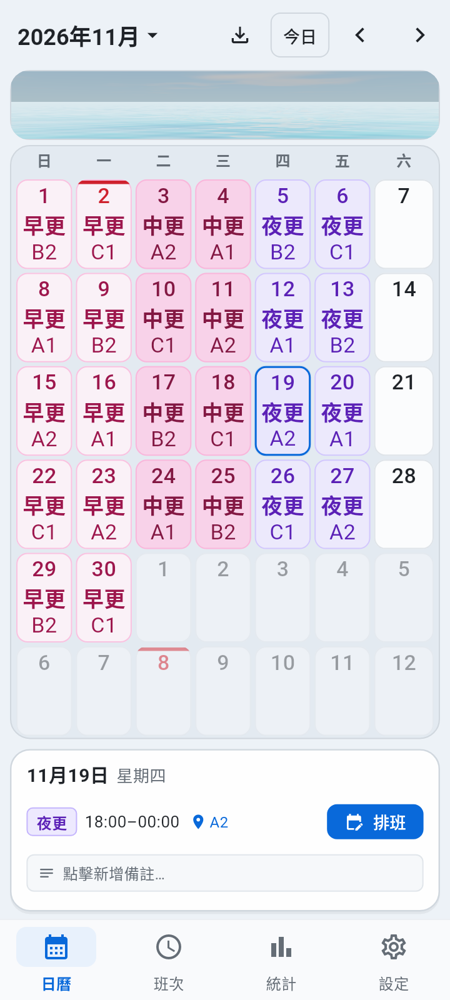
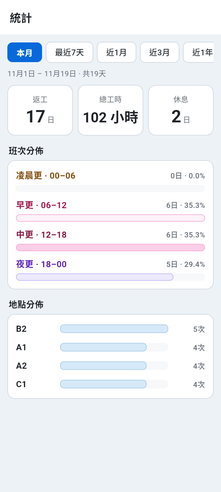
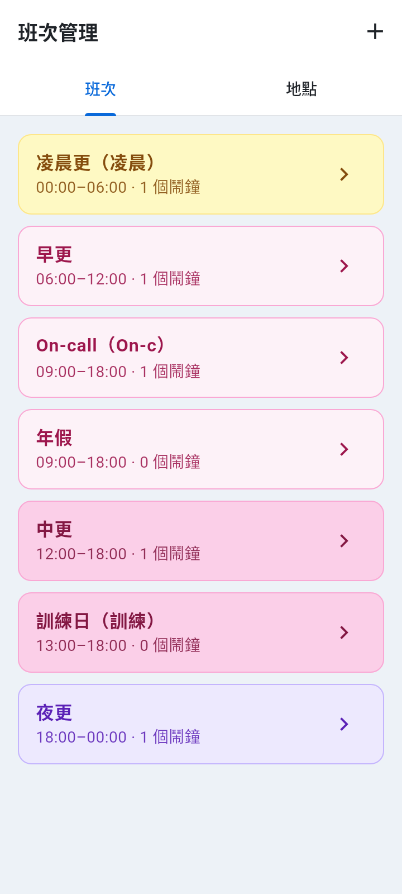
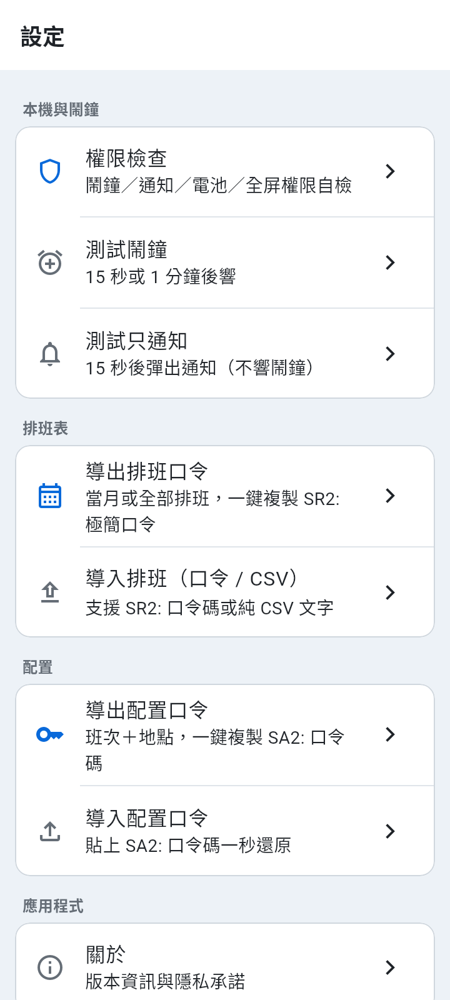

# ShiftAlarm 排班鬧鐘 ⏰

[](https://flutter.dev)
[-3DDC84?logo=android&logoColor=white)](https://windowmmk.github.io/ShiftAlarm/)
[](https://github.com/windowmmk/ShiftAlarm)
[](LICENSE)
[](https://github.com/windowmmk/ShiftAlarm/releases)
[](https://github.com/windowmmk/ShiftAlarm/actions/workflows/ci.yml)

專為輪班與排班人士打造的**極致隱私、純離線**排班日曆與精確鬧鐘（Flutter / Android 原生整合 / Web PWA）。

🌐 **線上體驗 Web 版**：[https://windowmmk.github.io/ShiftAlarm/](https://windowmmk.github.io/ShiftAlarm/)

<p align="center">
  
  &nbsp;
  
  &nbsp;
  
  &nbsp;
  
</p>

<p align="center">
  <sub>日曆主畫面（天色帶／月曆／排班詳情） · 工時統計 · 班次管理 · 設定與分享</sub>
</p>

> 以上為**真實 UI 截圖**，由 `tool/gen_screenshots_test.dart` 經 Flutter 渲染管線直接輸出，非設計稿或合成圖。

---

## 🔒 核心承諾：極致隱私與純離線

- **100% 離線**：Android 層級**完全未申請 `INTERNET` 權限**，在物理層面杜絕聯網可能。
- **無帳號、無雲端**：班次、排程與備註全數存放本機，永不離開裝置。
- **零追蹤、零廣告**：無 Firebase、無 Crashlytics、無任何第三方追蹤分析或廣告 SDK。
- **開源可審計**：全開源，程式碼乾淨透明，隨時接受社群審查。

---

## ✨ 功能一覽

### 🖥️ 三區固定版面與淺色極簡風格

- 頂部天色帶／中間月曆／底部排班詳情，**三區高度比例固定，無彈出彈入抖動**；可用高度不足時天色帶讓位（96px → 下限 56px），輸入文字鍵盤彈起時**完全壓縮為 0**。
- 天色帶、月曆卡與底部詳情卡共用同一套最大寬度、描邊、圓角與內縮規範，桌面與手機寬度皆精準對齊。

### 🌊 天色帶與四時天空

- Android 與 Web **共用同一套 fragment shader**（`shaders/ocean.frag`），提供 9 層傅立葉物理波高、次表面散射、太陽碎鑽光斑與星夜藍眼淚；裝置不支援時自動無縫降級至 2D 海洋繪製器。
- 依真實時辰自動切換四時天色：🌅 晨曦破曉（05:00–10:59）、☀️ 碧海晴空（11:00–16:29）、🌇 金暉落日（16:30–21:29）、🌌 星夜藍眼淚（21:30–04:59）。

### 📅 月曆與排班

- **標準 42 格固定網格**（每月 6 行），消除跨月高度撕裂；日曆格理想高度 75px。
- 點選觸覺回饋、年月快速跳轉面板、**公眾假期紅線標註**、每日常駐便利貼備註。
- Web 端 60fps：`RepaintBoundary` 隔離重繪與平滑左右翻頁。

### ⏰ 精準輪班鬧鐘（Android 原生）

- 每班次最多 10 組鬧鐘；原生 `AlarmManager` 精確調度，鎖屏全屏喚醒（前台服務＋系統鬧鐘鈴聲），並自動適配高對比班次色彩。
- **響前 1 小時倒計時預告**：以狀態欄倒計時呈現，**僅限真鬧鐘**（純通知類打卡不發預告）；響鬧自動撤下，開機／覆蓋更新／跨時區由 `BootReceiver` 自動重建。
- 內建精確鬧鐘、全屏通知、電池最佳化白名單與當機紀錄**權限自檢儀表板**。

### 🔗 分享與導入（SA2 / SR2 極簡二進制協議）

- **體積壓縮 90%+**：配置口令 `SA2:<Base58>` 壓至 90–115 字元，整月排班 `SR2:<Base58>` 壓至 150–230 字元。
- **CRC32 防偽校驗**：IEEE 802.3 CRC32 與 UNIX 時間戳內嵌於二進制前導區，防截斷與竄改。
- 支援網址一鍵導入（`?c=SA2:...`／`?r=SR2:...`，微信友善無 `#`）、剪貼簿即時辨識、面對面 QR Code 與純 CSV 雙模導入。

### 📊 統計與班次管理

- 多維區間統計（本月／近 7 天／近 1 月／近 3 月／近 1 年／今年起／去年全年）、**班次名稱＋時段分佈**與地點分佈圖表。
- **總工時按實際班次長度**逐筆計算，支援跨午夜班次，顯示「X 小時 Y 分」。
- 班次編輯器內建 **1:1 日曆格即時預覽**（所見即所得，不受系統大字體失真影響）；地點輸入自動補全歷史紀錄。

---

## 📂 專案結構

```text
ShiftAlarm/
├── android/app/src/main/kotlin/com/shiftalarm/app/
│   ├── MainActivity.kt               # Flutter 入口，註冊 MethodChannel
│   ├── AlarmChannelHandler.kt        # MethodChannel 鬧鐘排程與三通道對帳
│   ├── PermissionHelper.kt           # Android 系統權限查詢與設定頁跳轉
│   ├── AlarmScheduler.kt             # AlarmManager 精確排程與取消
│   ├── AlarmIdRegistry.kt            # 三通道 id 註冊表與幽靈清理
│   ├── AlarmReceiver.kt              # 鬧鐘觸發、強制亮屏與前台服務啟動
│   ├── AlarmSoundService.kt          # 前台鈴聲與震動服務
│   ├── AlarmActionReceiver.kt        # 通知列停止／5 分鐘貪睡動作處理
│   ├── AlarmActivity.kt              # 鎖屏全屏喚醒頁
│   ├── AlarmUiStyles.kt              # 高對比調色板與原生元件繪製工具
│   ├── GentleAlarmReceiver.kt        # 純通知提醒接收器
│   ├── PreAlertScheduler.kt          # 響前 1 小時預告排程器
│   ├── PreAlertDismissStore.kt       # 預告手動關閉版本記錄
│   ├── PreAlertReceiver.kt           # 狀態欄倒計時通知發布器
│   ├── BootReceiver.kt               # 開機／更新／時區變更廣播接收器
│   ├── BootRescheduler.kt            # 原生 SharedPreferences 解析與重排引擎
│   ├── AlarmDebugLog.kt              # 鬧鐘事件除錯日誌
│   └── CrashApp.kt                   # 全域未捕捉異常記錄
├── lib/
│   ├── alarm/                        # MethodChannel 橋接層（shift_alarm/alarm）
│   ├── domain/                       # 純 Dart 領域層：shift_models、shift_store、alarm_service、
│   │                                 #   config_io、roster_io、base58、csv_import、holidays、
│   │                                 #   stats、shift_time、calendar_layout
│   ├── theme/                        # 設計 Token 與色彩規範（app_theme.dart）
│   ├── ui/
│   │   ├── screens/
│   │   │   ├── calendar/             # 日曆子元件：day_cell、month_grid、detail_card、
│   │   │   │                         #   month_picker、url_import_handler
│   │   │   ├── calendar_screen.dart  # 日曆主頁編排
│   │   │   ├── home_screen.dart      # 四頁籤底部導覽框架
│   │   │   ├── shift_manage_screen.dart / shift_edit_screen.dart
│   │   │   ├── shift_picker_panel.dart
│   │   │   ├── stats_screen.dart
│   │   │   ├── settings_screen.dart
│   │   │   └── permission_check_screen.dart
│   │   ├── dialogs/                  # unified_import、share_export、alarm_edit、about
│   │   └── widgets/                  # ocean_band、ocean_shader_controller、ocean_presets、
│   │                                 #   ocean_atmo_state、ocean_atmosphere、ocean_fallback_painter、
│   │                                 #   ocean_import_transition、top_notification
│   ├── config.dart                   # 版本常數（與 pubspec.yaml 同步）
│   └── main.dart                     # App 入口與全域錯誤防護
├── shaders/                          # Android 與 Web 共用的 ocean.frag
├── tool/                             # 跨平台真實截圖產生器（gen_screenshots_test.dart）
├── docs/screenshots/                 # README 真實 UI 截圖
└── test/
    ├── domain/                       # 領域邏輯、協議編解碼、資料韌性測試
    ├── alarm/                        # 鬧鐘時刻、打卡、響前預告測試
    ├── ocean/                        # 著色器 uniform 佈局、渲染與省電空閒測試
    └── ui/                           # 版面對齊、高度量測、全介面響應式溢出防線
```

---

## 🛠️ 開發與建置

### 環境需求

- **Flutter SDK**：3.47+（Dart `^3.13.5`）
- **JDK**：OpenJDK 17
- **Android**：`minSdk` 由 Flutter Gradle Plugin 帶入（現值 **24**）

### 快速開始

```bash
git clone https://github.com/windowmmk/ShiftAlarm.git
cd ShiftAlarm
flutter pub get
flutter analyze                 # 靜態分析（維持 0 issues）
flutter test                    # 執行全部分層測試
flutter build apk --release     # 建置 Android Release APK
flutter build web --release     # 建置 Web PWA
```

### CI / 發版與簽名安全

| Workflow | 觸發條件 | 執行內容與產物 |
|---|---|---|
| `ci.yml` | 任何分支 push / PR | `flutter analyze`（0 issues 閘門）＋全量 `flutter test`＋Web／Android 建置檢查＋實機截圖產出 |
| `deploy-web.yml` | push `main` | 靜態分析＋測試＋自動部署至 GitHub Pages |
| `build-apk.yml` | 推送 `v*` Tag（或手動觸發） | 由 GitHub Secrets 還原簽名金鑰建置 Release APK，並自動擷取 `CHANGELOG.md` 釋出 GitHub Release |

Release APK 簽名憑證完全託管於 GitHub Repository Secrets（不進入版本庫追蹤）：
- `KEYSTORE_BASE64`：Release Keystore 的 Base64 編碼內容
- `KEYSTORE_PASSWORD` / `KEY_ALIAS` / `KEY_PASSWORD`：金鑰庫簽名憑證

---

## 🧪 測試與防線

CI 強制要求 `flutter analyze` **0 issues** 且全部測試通過，重點防線如下：

| 測試檔案 | 驗證範疇 |
|---|---|
| `test/ui/layout_overflow_sweep_test.dart` | 核心介面 × 多寬度 × 多系統字體縮放，掃描所有 `RenderFlex` 確保零溢出 |
| `test/ui/ui_polish_test.dart` | 繁體文案統一、班次名稱去重、統計頁名稱＋時段渲染與響應式零溢出 |
| `test/ui/band_card_alignment_test.dart` | 320／360／412／900px 驗證天色帶與日曆卡左右對齊及格線對比度 |
| `test/ui/calendar_layout_measure_test.dart` | 三區固定高度實算與鍵盤讓位精準對帳 |
| `test/domain/store_resilience_test.dart` | 損壞 JSON 隔離備份與孤兒排班防資料蒸發 |
| `test/alarm/pre_alert_verify_test.dart` | 響前預告僅限真鬧鐘、倒計時終點與幽靈清理驗證 |

### 重新產生 README 截圖

```bash
flutter test tool/gen_screenshots_test.dart --plain-name home
flutter test tool/gen_screenshots_test.dart --plain-name stats
flutter test tool/gen_screenshots_test.dart --plain-name shifts
flutter test tool/gen_screenshots_test.dart --plain-name settings
```

---

## 📜 版本紀錄

完整變更紀錄請見 [CHANGELOG.md](CHANGELOG.md)。

---

## 📄 開源授權

本專案採用 [MIT License](LICENSE) 授權開放。
