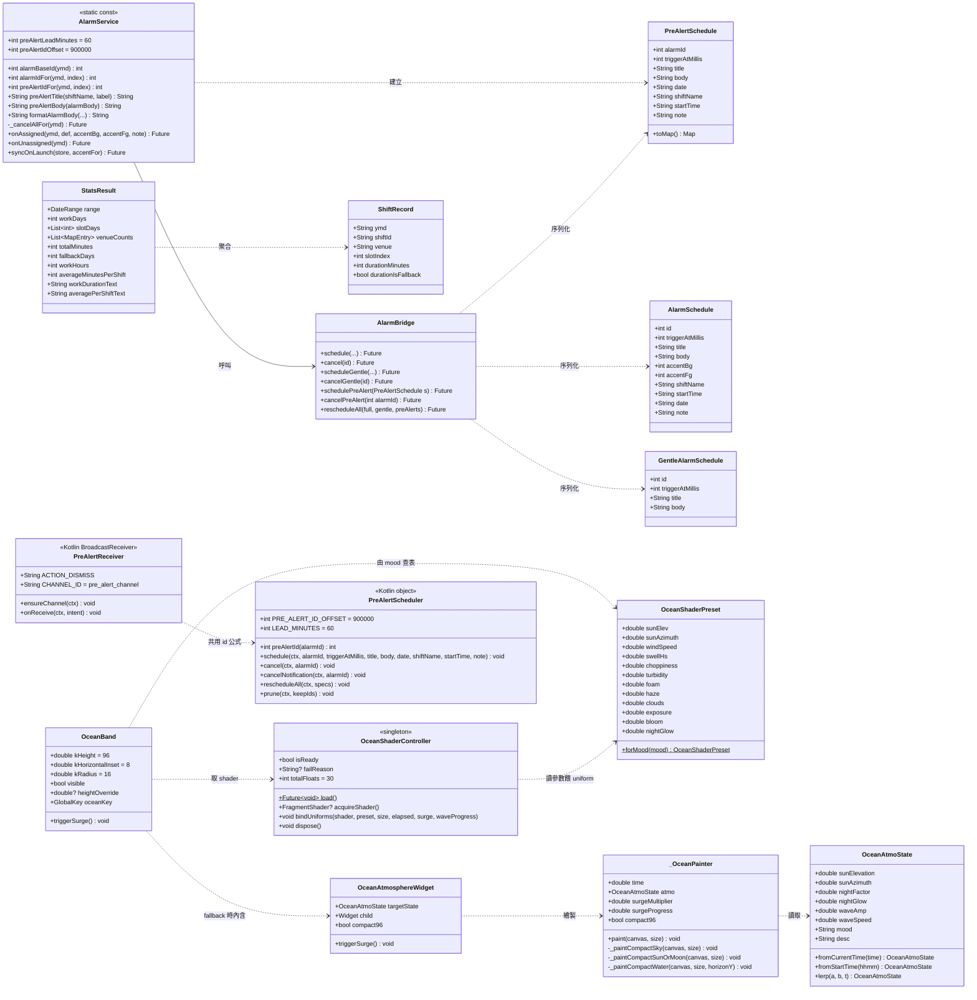
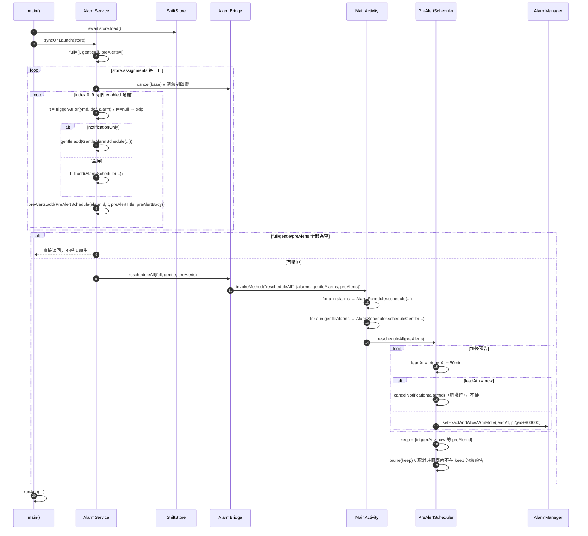
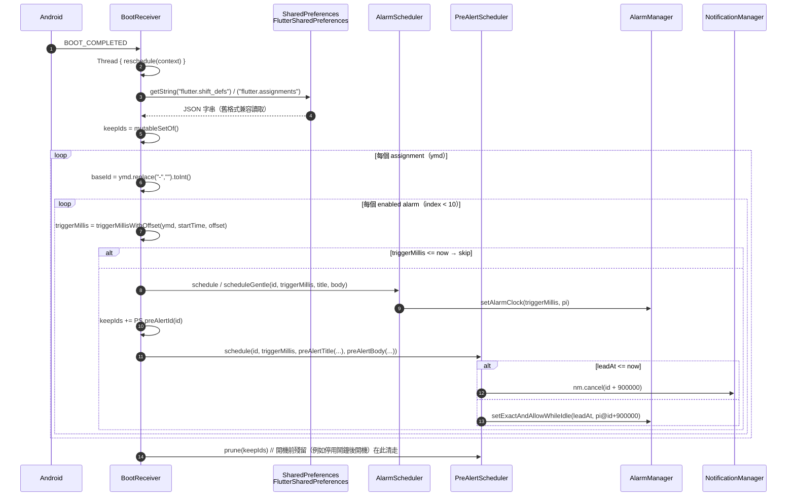
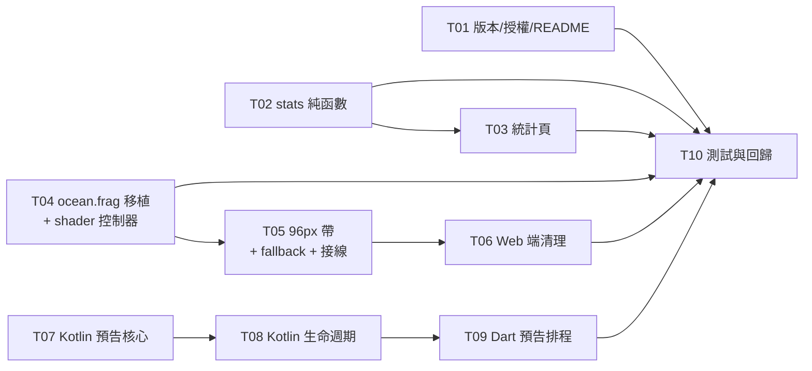

# ShiftAlarm v3.5.0 增量架構設計

> 撰寫：高見遠（架構師）｜基線 v3.4.5+43 → 目標 **v3.5.0+44**
> 上游文件：`docs/v3.5/PRD.md`（許清楚）
> 本文只講**怎麼做**，不重述需求。

> ## ⚠️ 架構 v2 修訂（優先於本文件任何舊段落）
> 使用者已明確推翻 PRD **D4**（Web 收斂到 Flutter 繪製器）與本文件初版的 §7.5：
> 「我就是要用 WebGL 那套的, 真實光影的」
>
> 現行方向：**兩端共用一套 Flutter GPU fragment shader（`shaders/ocean.frag`）做真光影**，海平線帶由 56px 改為 **96px**。
> 完整偏離記錄與理由見 **§9 PRD 偏離記錄**。凡本文件與 §9 衝突之處，**以 §9 為準**。

---

## 0. 三個改動群與回滾邊界（先看這個）

本次改動切成**三個互不相干的群組**，各自可以獨立合併、獨立回滾：

| 群組 | 內容 | 涉及層 | 回滾方式 |
| --- | --- | --- | --- |
| **A 工時與版本** | 統計口徑、LICENSE、版本號 | 純 Dart，零平台依賴 | revert 單一 commit，無殘留 |
| **B 海洋真光影** | `shaders/ocean.frag` 移植、96px 海平線帶、Web 清理 | Dart UI + GPU shader + Web | revert 單一 commit；`web/ocean_shader.js` 仍在 repo 作移植參照，`_OceanPainter` 仍留作 fallback，可一步降級 |
| **C 鬧鐘預告** | 第三條通知通道 | Dart 橋 + Kotlin | revert 單一 commit；已排的預告 PendingIntent 會殘留至下次 `syncOnLaunch` 被 prune 清走（見 §3.4） |

**建議 commit 順序：A → B → C**。A 完全沒有視覺風險，可以先上；B 有 GPU／視覺風險（且 B 內部再切 B1 shader 移植 / B2 帶元件 / B3 Web 清理三個 commit）；C 有系統行為風險。任何一步出問題都不會拖累前一步。

---

## 1. 實作方案總覽

| 需求 | 改哪個檔案 | 用什麼手法 |
| --- | --- | --- |
| P0-1 移除全屏海洋、加 **96px** 帶 | `lib/ui/screens/calendar_screen.dart:535-543` | 刪掉 `Stack` + `Positioned.fill`，`Column` 直接做 body；在 `Expanded`（月曆）與 `AnimatedSize`（面板）之間插入新元件 `OceanBand`（內部用 `FragmentShader` 繪製） |
| P0-2 靜態底色 | `calendar_screen.dart:475` + `lib/theme/app_theme.dart` | `backgroundColor: Colors.transparent` → `kCalendarPageBg`（見 §6.5，**不是** PRD 寫的 #F8FAFC，已裁示改用 #EDF2F7，理由見 §8-Q1） |
| P0-3 **真光影**（取代原 compact 模式） | 新增 `shaders/ocean.frag` + `lib/ui/widgets/ocean_shader_controller.dart` | 把 `web/ocean_shader.js` 的 GLSL 光線步進移植成 Flutter `.frag`；**投影必須改寫**（見 §3.5.3），其餘著色邏輯可原封搬 |
| P0-4 只跟真實時間 + 60s Timer | 新增 `lib/ui/widgets/ocean_band.dart` | 60 秒 Timer **放在帶內部**（`OceanBandState`），`calendar_screen` 完全不 `setState`；刪除 `_getCurrentAtmoState()`（150-162 行） |
| P0-5 面板打開收合 | `ocean_band.dart` | `AnimatedSize(200ms, clipBehavior 預設 hardEdge)` + `AnimatedOpacity(200ms)`，`visible: !(_showDetailPanel \|\| _schedPanelOpen)` |
| P0-6 Web 端改用同一份 `.frag` | `web/index.html` + 刪 3 個 `ocean_bridge*.dart` | 移 `<canvas>`、移 `<script>`；`ocean_atmosphere.dart` 移除 `kIsWeb` 早退與 `jsSetOceanAtmosphere` 呼叫；Web 由 `FragmentShader` 直接繪製（CanvasKit/skwasm 支援 SkSL） |
| P0-7 預告排程 | `lib/domain/alarm_service.dart` + 新 Kotlin `PreAlertScheduler.kt` | Dart 在 `onAssigned` / `syncOnLaunch` 為**每個 enabled 鬧鐘**（兩條通道都算）多排一條預告，走新 channel method `schedulePreAlert`；Kotlin 用 **`setExactAndAllowWhileIdle`**（不是 `setAlarmClock`，見 §7.5） |
| P0-8 獨立頻道／ongoing／知道了 | 新 Kotlin `PreAlertReceiver.kt` + `AndroidManifest.xml` | 新頻道 `pre_alert_channel`；`setOngoing(true)` + `addAction("知道了")`；**不重用** `GentleAlarmReceiver` 的「刪頻道重建」邏輯 |
| P0-9 生命週期同步 | `alarm_service.dart:117-131`（`_cancelAllFor`）+ Kotlin `AlarmReceiver` / `GentleAlarmReceiver` / `rescheduleAll` | 三個取消時機全部補上：①`_cancelAllFor` 逐個 index cancel ②鬧鐘響時 `nm.cancel(id+900000)` ③重排時同 id 覆蓋 + 註冊表 prune |
| P0-10 距響不足 60 分鐘不發 | Kotlin `PreAlertScheduler.schedule()` | `leadAt = triggerAt - 60min`；`if (leadAt <= now) { cancel(id); return }`。判斷**只在 Kotlin 一處**，Dart 不重複判斷 |
| P0-11 實際班時 | `lib/domain/stats.dart` | 新增頂層純函數 `shiftDurationMinutes()`；`ShiftRecord` 加 `durationMinutes` / `durationIsFallback` |
| P0-12 分鐘累加、顯示到分鐘 | `stats.dart` + `lib/ui/screens/stats_screen.dart` | `StatsResult.totalMinutes` 做單一真相來源，`workHours` 改 `totalMinutes ~/ 60`；新增 `formatDurationMinutes()` |
| P1-1 LICENSE | 新 `LICENSE` | MIT 全文 |
| P1-2 預告文案 | `alarm_service.dart` | `preAlertTitle()` / `preAlertBody()` 兩個 static 方法，內文**串接** `formatAlarmBody()` 結果，零複製 |
| P1-3 平均每更 | `stats_screen.dart` | 總工時卡下方加一行 caption |
| P1-4 fallback 標註 | `stats_screen.dart` | `StatsResult.fallbackDays > 0` 時顯示 `*` 與 footnote |
| P2-* | — | **v3.5.0 全部不做**（見 §8-Q3） |

---

## 2. 檔案清單

| 路徑 | 動作 | 職責 |
| --- | --- | --- |
| `pubspec.yaml` | 改 | `version: 3.5.0+44`（**已由 team-lead 改好**，不動 dependencies，C2）；**新增 `flutter: shaders: - shaders/ocean.frag`**（**必須等 frag 檔存在後才加**，先加會令 `flutter test` 全紅） |
| `lib/main.dart` | 改 | 加 §7.12 的渲染器標記：`[OCEAN] renderer=pending` → `shader` / `fallback reason=...`（`debugPrint`、不 await、不阻塞啟動） |
| `lib/config.dart` | 改 | `kAppVersion='3.5.0'`、`kAppBuildNumber=44` |
| `LICENSE` | **新增** | MIT 全文，`Copyright (c) 2026 ShiftAlarm` |
| `README.md` | 改 | 刪「全屏 3D 海洋」的**全屏**表述（改寫為「96px 海平線帶・GPU 光線步進」）；加 v3.5.0 段落（海平線帶、響鬧預告、工時修正）；`Release-v3.4.5` badge → `v3.5.0` |
| `lib/domain/stats.dart` | 改 | `shiftDurationMinutes()`、`formatDurationMinutes()`；`ShiftRecord` +2 欄位；`StatsResult` +2 欄位、`workHours` 改口徑、`averageMinutesPerShift` |
| `lib/ui/screens/stats_screen.dart` | 改 | `_compute()` 傳 `durationMinutes`；總工時卡改顯示「X 小時 Y 分」；平均副標；fallback `*` |
| `shaders/ocean.frag` | **新增** | GLSL fragment shader：由 `web/ocean_shader.js` 移植的光線步進海洋（天空／雲／日月／9 波疊加／菲涅耳／次表面散射／藍眼淚／衝擊環／ACES tone map）。**投影部分重寫**，見 §3.5 |
| `lib/ui/widgets/ocean_shader_controller.dart` | **新增** | `OceanShaderController`：全域一次 `FragmentProgram.fromAsset` 載入、快取、`FragmentShader` 建立／`dispose`、uniform 綁定（19 個 uniform／30 個 float，見 §3.5.2）、失敗回報 `bool isReady` |
| `lib/ui/widgets/ocean_presets.dart` | **新增** | `OceanShaderPreset`：由 `SHIFT_OCEAN_PRESETS`（M/A/S/N/O/OT 六組）移植的 Dart 常數表；`forMood(String mood)` 由 `OceanAtmoState.mood` 查表 |
| `lib/ui/widgets/ocean_band.dart` | **新增** | `OceanBand`：96px 帶、圓角 16、左右內縮 8、`maxWidth 480` 居中、`RepaintBoundary`、`ClipRRect`、60s Timer、收合動畫、`triggerSurge()` 轉發、**shader 未就緒時自動退回 `_OceanPainter`** |
| `lib/ui/widgets/ocean_atmosphere.dart` | 改 | `_OceanPainter` **不刪**，降級為 fallback；新增 `compact96` 幾何分支（96px 參數見 §6.4）；刪 `kIsWeb` 早退（253-258）；刪 `_syncWebAtmosphere()` 及兩處呼叫；刪 `import 'ocean_bridge.dart'` |
| `lib/ui/screens/calendar_screen.dart` | 改 | 移除 `Stack`/`Positioned.fill`（535-543）；插 `OceanBand`；`Scaffold.backgroundColor`；刪 `_getCurrentAtmoState()`（150-162）；今日脈衝圈局部化（見 §7.2）；`LayoutBuilder` 算帶高（見 §7.10） |
| `lib/theme/app_theme.dart` | 改 | 新增 `kCalendarPageBg`、`kOceanBandHeight = 96` 等常數（見 §6.4） |
| `lib/ui/widgets/ocean_bridge.dart` | **刪除** | 條件導出，已無引用者（Web 改由 `.frag` 繪製） |
| `lib/ui/widgets/ocean_bridge_web.dart` | **刪除** | `dart:js` 已棄用 API，無引用者即死碼 |
| `lib/ui/widgets/ocean_bridge_stub.dart` | **刪除** | 同上 |
| `web/index.html` | 改 | 移 `<canvas id="oceanBgCanvas">`、移 `<script src="ocean_shader.js">`、移 `#oceanBgCanvas` CSS、`html/body` 底色改 `#EDF2F7`、`flutter-view` 規則改 `#EDF2F7`、`meta theme-color` 改 `#EDF2F7` |
| `web/manifest.json` | 改 | `background_color: "#EDF2F7"`（與頁面底色一致，避免 PWA 啟動白閃） |
| `web/ocean_shader.js` | 改（僅檔頭） | 加 3 行註解：「已由 `shaders/ocean.frag` 取代，僅作移植參照，不參與執行」。**檔案保留、不刪**（§9） |
| `lib/alarm/alarm_bridge.dart` | 改 | 新增 `PreAlertSchedule` 類；`schedulePreAlert()` / `cancelPreAlert()`；`rescheduleAll()` 加第三個參數 `preAlerts` |
| `lib/domain/alarm_service.dart` | 改 | `preAlertLeadMinutes` / `preAlertIdOffset` / `preAlertIdFor()` / `preAlertTitle()` / `preAlertBody()`；`_cancelAllFor` 加 cancel；`onAssigned` / `syncOnLaunch` 加排程 |
| `android/app/src/main/kotlin/com/shiftalarm/app/PreAlertScheduler.kt` | **新增** | AlarmManager 排程／取消、`preAlertId()` 轉換、`LEAD_MINUTES` 常數、id 註冊表 prune |
| `android/app/src/main/kotlin/com/shiftalarm/app/PreAlertReceiver.kt` | **新增** | 頻道建立、通知組裝、`知道了` action、點擊開 App |
| `android/app/src/main/kotlin/com/shiftalarm/app/MainActivity.kt` | 改 | `when(call.method)` 加 `schedulePreAlert` / `cancelPreAlert`；`rescheduleAll` 讀 `preAlerts` |
| `android/app/src/main/kotlin/com/shiftalarm/app/AlarmReceiver.kt` | 改 | `onReceive` 取 id 後立即 `PreAlertScheduler.cancelNotification(context, id)` |
| `android/app/src/main/kotlin/com/shiftalarm/app/GentleAlarmReceiver.kt` | 改 | 非 DISMISS 分支加同一句 |
| `android/app/src/main/kotlin/com/shiftalarm/app/BootReceiver.kt` | 改 | 每個 alarm 排完後排預告；結尾 `prune`；新增 `preAlertTitle/Body` 兩個私有方法（**重用既有 `formatAlarmBody`**） |
| `android/app/src/main/AndroidManifest.xml` | 改 | `<receiver android:name=".PreAlertReceiver" android:exported="false" />` |
| `test/stats_test.dart` | 改 | 補 P0-11 五個邊界 + P0-12 格式測試；既有斷言**不需改**（見 §7.7） |
| `test/pre_alert_test.dart` | **新增** | 純 Dart 測 `preAlertIdFor` 三組 id 互斥（C7）、`preAlertTitle/Body` 文案、`leadAt` 邊界算法 |
| `test/ocean_uniform_test.dart` | **新增** | §7.9 第二層護欄：讀 `shaders/ocean.frag` 數 uniform 格數，斷言 `== _U.totalFloats == 30` |
| `docs/v3.5/ARCH.md` | 新增 | 本文件 |

---

## 3. 資料結構與介面

### 3.1 類別圖（Dart + Kotlin 混合）



### 3.2 Dart 側介面（逐條簽名）

**`lib/domain/alarm_service.dart` 新增（全部 `static`，零狀態）**

```dart
/// 預告提前量（分鐘）。固定 60，不做可配置（PRD D5）。
/// ⚠️ 必須與 Kotlin `PreAlertScheduler.LEAD_MINUTES` 保持一致。
static const int preAlertLeadMinutes = 60;

/// 預告 id 命名空間偏移。全鬧鐘/只通知用 id，預告用 id + 900000。
/// ⚠️ 必須與 Kotlin `PreAlertScheduler.PRE_ALERT_ID_OFFSET` 保持一致。
static const int preAlertIdOffset = 900000;

/// 預告 id（僅供測試斷言三組 id 互斥；實際轉換由 Kotlin 做，見 §3.4）
static int preAlertIdFor(String ymd, int index) =>
    alarmIdFor(ymd, index) + preAlertIdOffset;

/// 預告標題：「1 小時後：早更 開工打卡」
static String preAlertTitle(String shiftName, String label) =>
    '1 小時後：$shiftName $label';

/// 預告內文：「仲有 1 小時響 · 開工時間到了，記得打卡！ (06:00) · 地點：瑪麗醫院」
/// 必須串接 formatAlarmBody 的輸出，不准另寫文案（PRD 提示 4）
static String preAlertBody(String alarmBody) => '仲有 1 小時響 · $alarmBody';
```

**`lib/alarm/alarm_bridge.dart` 新增**

```dart
/// 響鬧預告排程（第三條通道）。
/// `alarmId` 係**原始鬧鐘 id**（未加偏移），原生側負責 +900000 與 -60 分鐘。
class PreAlertSchedule {
  final int alarmId;
  final int triggerAtMillis; // 鬧鐘觸發時刻，不是預告時刻
  final String title;
  final String body;
  final String date;
  final String shiftName;
  final String startTime;
  final String note;

  const PreAlertSchedule({
    required this.alarmId,
    required this.triggerAtMillis,
    required this.title,
    required this.body,
    this.date = '',
    this.shiftName = '',
    this.startTime = '',
    this.note = '',
  });

  Map<String, Object?> toMap() => { ... }; // 同既有 toMap 風格
}

Future<void> schedulePreAlert(PreAlertSchedule s) =>
    _ch.invokeMethod('schedulePreAlert', s.toMap());

Future<void> cancelPreAlert(int alarmId) =>
    _ch.invokeMethod('cancelPreAlert', {'alarmId': alarmId});

// 簽名擴充（第三個參數為 required，令漏傳即編譯失敗）
Future<void> rescheduleAll(
  List<AlarmSchedule> full,
  List<GentleAlarmSchedule> gentle,
  List<PreAlertSchedule> preAlerts,
) => _ch.invokeMethod('rescheduleAll', {
      'alarms': full.map((a) => a.toMap()).toList(),
      'gentleAlarms': gentle.map((a) => a.toMap()).toList(),
      'preAlerts': preAlerts.map((p) => p.toMap()).toList(),
    });
```

> `AlarmSchedule` / `GentleAlarmSchedule` **不擴充**。預告需要 `date/shiftName/startTime/note` 是為了 P2-2（點擊跳日期）預留，但 P2 不做，故這四個欄位在原生側只寫入 log 不消費——保持通道契約穩定，避免日後再加一次。

**`lib/domain/stats.dart` 新增／修改**

```dart
/// 班次實際時長（分鐘）。零 Flutter 依賴的頂層純函數。
/// 規則（PRD D9）：
///   start/end 任一為空或解析失敗 → 360（fallback）
///   end == start                  → 0（填錯時間寧可顯示 0）
///   end <  start                  → 視為跨午夜，(end-start) % 1440
/// ⚠️ 與 ShiftDef.durationMinutes 的算式必須一致（空值行為不同，見 §7.7）
int shiftDurationMinutes(String? startTime, String? endTime);

/// 「X 小時 Y 分」；Y == 0 → 「X 小時」；負數或 0 → 「0 小時」
String formatDurationMinutes(int totalMinutes);

class ShiftRecord {
  final String ymd;
  final String shiftId;
  final String venue;
  final int slotIndex;
  final int durationMinutes;      // 新增，預設 360
  final bool durationIsFallback;  // 新增，預設 false（true = 用 fallback 360）

  const ShiftRecord({
    required this.ymd,
    required this.shiftId,
    required this.slotIndex,
    this.venue = '',
    this.durationMinutes = 360,   // ← 預設值令既有 test/stats_test.dart 全部仍然通過
    this.durationIsFallback = false,
  });
}

class StatsResult {
  final int totalMinutes;   // 新增：單一真相來源
  final int fallbackDays;   // 新增：用了 fallback 360 的日數（P1-4）

  /// 保留欄位，改口徑：向下取整（PRD D9）
  int get workHours => totalMinutes ~/ 60;

  int get averageMinutesPerShift =>
      workDays == 0 ? 0 : totalMinutes ~/ workDays;

  String get workDurationText => formatDurationMinutes(totalMinutes);

  String get averagePerShiftText =>
      workDays == 0 ? '平均每更 0 小時' : '平均每更 ${formatDurationMinutes(averageMinutesPerShift)}';
}
```

**不變量（工程師必須守住）**
1. `totalMinutes == Σ（`seen` 通過的第一筆 ShiftRecord 的 durationMinutes）`——同一日多筆只計一次，與 `workDays` 同一 gate。
2. `fallbackDays <= workDays`。
3. `workHours == totalMinutes ~/ 60`，永不等於 `workDays * 6`。
4. `durationMinutes ∈ [0, 1439]`（`(e-s)%1440` 天然保證）或恰為 360。

### 3.3 Kotlin 側介面

```kotlin
// PreAlertScheduler.kt
object PreAlertScheduler {
    const val PRE_ALERT_ID_OFFSET = 900000
    const val LEAD_MINUTES = 60
    const val EXTRA_PRE_ALERT_DATE = "pre_alert_date"

    /** 唯一轉換點：鬧鐘 id → 預告 id（同時用作通知 id 與 PendingIntent requestCode） */
    fun preAlertId(alarmId: Int): Int = alarmId + PRE_ALERT_ID_OFFSET

    /**
     * 排一條預告。
     * triggerAtMillis = 鬧鐘觸發時刻（不是預告時刻）。
     * leadAt = triggerAtMillis - LEAD_MINUTES*60_000
     * leadAt <= now → 取消舊預告並直接 return（D8：不發、不補發）
     *
     * ⚠️ 用 setExactAndAllowWhileIdle，**不是** setAlarmClock（已裁示，見 §7.5）。
     *    理由：setAlarmClock 會令系統時鐘 App 的「下一個鬧鐘」顯示預告時間，
     *    污染使用者判斷「幾點會被叫醒」的唯一權威來源。
     *    代價（Doze 下最多遲約 15 分鐘）已接受；真鬧鐘本身仍走 setAlarmClock。
     *    因此**不需要** showIntent / AlarmClockInfo。
     */
    fun schedule(
        context: Context, alarmId: Int, triggerAtMillis: Long,
        title: String, body: String,
        date: String = "", shiftName: String = "",
        startTime: String = "", note: String = ""
    )

    /** 取消預告：PendingIntent + 通知一併清（對應 Dart cancelPreAlert） */
    fun cancel(context: Context, alarmId: Int)

    /** 只清通知，不動 AlarmManager（鬧鐘響嗰刻用） */
    fun cancelNotification(context: Context, alarmId: Int)

    /** 全量重排：逐條 schedule，之後 prune */
    fun rescheduleAll(context: Context, specs: List<Map<String, Any?>>)

    /**
     * 註冊表對帳：把「上次有、今次冇」的預告 id 全部 cancel 掉。
     * 契約（T07 驗收條件）：
     *  1. 幂等——同一 keepIds 連續呼叫兩次，第二次不得再 cancel 任何東西、不得改動註冊表。
     *  2. 全程 try/catch 吞掉任何異常（SharedPreferences 壞檔、nm 拋錯、PendingIntent 失效），永不 crash。
     *  3. keepIds 必須包含「leadAt 已過但鬧鐘未響」的 id（由呼叫方保證，見 §3.4），
     *     否則會誤殺正在通知欄掛着的預告。
     */
    fun prune(context: Context, keepIds: Set<Int>)
}
```

```kotlin
// PreAlertReceiver.kt
class PreAlertReceiver : BroadcastReceiver() {
    companion object {
        const val ACTION_DISMISS = "com.museai.shift_alarm.PRE_ALERT_DISMISS"
        const val CHANNEL_ID = "pre_alert_channel"
        const val CHANNEL_NAME = "響鬧預告"

        /** 只建立、**永不刪除重建**（見 §7.4） */
        fun ensureChannel(context: Context)
    }
    override fun onReceive(context: Context, intent: Intent)
}
```

**職責邊界（重要）**
- `PreAlertScheduler`：只碰 `AlarmManager` 與 id 註冊表。**不碰 Notification**（除了 `cancelNotification`）。
- `PreAlertReceiver`：只碰 `NotificationManager`。不碰 `AlarmManager`。
- 文案在 Dart 組好（`preAlertTitle` / `preAlertBody`），Kotlin 只負責顯示；唯一例外是 `BootReceiver`（無 Dart 可用），它重用自己已有的 `formatAlarmBody()` 組同一份文案（§6.3）。

### 3.4 預告通知的 id 公式與生命週期

**id 公式（三條通道互斥，C7）**

| 通道 | 通知 id | PendingIntent requestCode |
| --- | --- | --- |
| 全屏鬧鐘 | `id` | `id`（broadcast）、`id + 200000`（showIntent）、`100+id` / `200+id`（後備 stop/snooze） |
| 只通知 | `id` | `id`（broadcast）、`id + 500000`（知道了）、`id + 600000`（content）、`id + 700000`（showIntent） |
| **響鬧預告（新）** | `id + 900000` | `id + 900000`（broadcast）、`id + 800000`（知道了）、`id + 850000`（content） |

其中 `id = alarmBaseId(ymd) * 10 + index`，`index ∈ [0, 9]`。
`alarmBaseId` 最大 99991231（year 9999）→ `id ≤ 999912319` → `id + 900000 ≤ 1000812319 < Int.MAX_VALUE (2147483647)` ✅ 安全。

> **預告通道沒有 showIntent**：因為預告用 `setExactAndAllowWhileIdle` 而非 `setAlarmClock`（見 §7.5），不需要 `AlarmClockInfo`。所以 `id + 850000` 只由 `PreAlertReceiver` 的 content PendingIntent 使用，`id + 900000` 只作 AlarmManager 的 broadcast PI 與通知 id。

**生命週期：誰建立、誰取消**

| 時機 | 動作 | 由誰執行 | 位置 |
| --- | --- | --- | --- |
| 建立 | `setExactAndAllowWhileIdle(leadAt)` + `notify(preAlertId)` | `PreAlertScheduler.schedule` → `PreAlertReceiver.onReceive` | 排更 / 啟動 / 開機 |
| ① 使用者按「知道了」 | `nm.cancel(preAlertId)`，**不動 AlarmManager**（原鬧鐘照響，P0-8 ③） | `PreAlertReceiver`（`ACTION_DISMISS` 分支） | Kotlin |
| ② 鬧鐘真正響 | `nm.cancel(preAlertId)`，AlarmManager 的 PI 已自然消耗 | `AlarmReceiver.onReceive` 開頭、`GentleAlarmReceiver.onReceive` 非 DISMISS 分支 | Kotlin |
| ③ App 內取消／轉更／刪更 | `cancel(preAlertId)`（PI + 通知） | `AlarmService._cancelAllFor(ymd)` 迴圈內加一句 | Dart → Kotlin |
| ④ 重排覆蓋 | 同 `preAlertId` + `FLAG_UPDATE_CURRENT` 天然覆蓋；不再存在的由 `prune` 清走 | `PreAlertScheduler.rescheduleAll` | Kotlin |

**註冊表（`prune` 的資料來源）**
- 儲存：`context.getSharedPreferences("shiftalarm_prealerts", MODE_PRIVATE)`，key `"ids"`，值為逗號分隔的**已偏移 id**。
- `rescheduleAll` 流程：①逐條 `schedule()` ②`keep = { 所有 triggerAtMillis > now 的條目的 preAlertId }`（**包含 leadAt 已過、但鬧鐘未響的**，否則會誤殺正在通知欄掛着的預告）③`prune(keep)` ④寫回 `keep`。
- `prune` 的取消方式：`nm.cancel(preAlertId)` + `PendingIntent.getBroadcast(ctx, preAlertId, Intent(ctx, PreAlertReceiver::class), FLAG_UPDATE_CURRENT|IMMUTABLE).let { am.cancel(it); it.cancel() }`。`PendingIntent` 的比對不看 extras，所以不帶 extras 都能命中。

### 3.5 `shaders/ocean.frag`：可行性判定與介面

> **本節講「為什麼可行、哪裡會踩雷」。實作規格（uniform 表、相機數學、預設值、30fps）見 §9，衝突時以 §9 為準。**

#### 3.5.1 結論：**有條件可行**（7 條條件，見 §3.5.6）

現有 `web/ocean_shader.js` 的著色器**結構上非常適合**移植到 Flutter runtime effect，因為它避開了 Flutter 最頭痛的幾個限制：

| 檢查項 | 現況（逐行核對 `ocean_shader.js:155-350`） | 對 Flutter `.frag` 的影響 |
| --- | --- | --- |
| `texture` / sampler | **完全沒有**（純程序化雜訊 `hash12` + `noise2D`） | ✅ 不需要 `setImageSampler`，少一個最容易出錯的環節 |
| `while` 迴圈 | **沒有** | ✅ Flutter 不接受非常數上界的 `while` |
| `for` 迴圈 | **只有一個**：`for (int i = 0; i < 9; i++)`（第 283 行），上界是**字面常數 9** | ✅ 可直接 unroll，**不需要改寫** |
| `fbm()` | 3 段手工展開，**無迴圈** | ✅ 原封不動 |
| `discard` | **沒有** | ✅ 避開 Impeller 的 discard 問題 |
| `#version` 指令 | 只在外層 wrapper（141、352 行），`fsBody`（155-350）本身**沒有** | ✅ body 可直接搬，`#version` 丟掉 |
| `gl_FragCoord` | 只在 `main()`（356、360 行）用一次 | ⚠️ 改 `FlutterFragCoord()`，只改 1 行 |
| `out` 參數 | `mainImage(out vec4, in vec2)`（256 行） | ⚠️ 建議改成回傳值（見 §3.5.4 條件 ②） |
| `precision` 宣告 | `precision highp float;`（353、358 行） | ⚠️ 刪除（`runtime_effect.glsl` 已提供） |
| `mat2` 全域常數 | `const mat2 m2 = mat2(...)`（197 行） | ✅ SkSL 支援 |
| uniform 型別 | 只有 `float` / `vec2` / `vec3`，**無矩陣、無陣列、無 sampler** | ✅ 全部可用 `setFloat` 餵 |
| 高次冪 | `pow(sunCos, 220.0)`（251 行） | ⚠️ 必須 `highp`，否則夜間日冕會爆雜訊 |
| 分支 | 3 個 `if`（242、266、299、336），無資料相依迴圈 | ✅ 可接受 |

**真正卡住的只有一件事**：**投影**。原 shader 的 FOV 是為 16:9 全屏寫死的，直接搬到 4.8:1 的帶上會壞掉（見 §3.5.3）。這一條可解，但必須重寫，不是搬。

#### 3.5.2 uniform 佈局表（**最易出錯的地方，逐格對**）

Flutter 的 `FragmentShader.setFloat(index, value)` 用的是**線性 float 索引**，按 shader 內 uniform 的**宣告順序**排列：`float` 佔 1 格、`vec2` 佔 2 格、`vec3` 佔 3 格、`vec4` 佔 4 格。**索引錯了不會報錯，只會靜默畫錯**（例如把太陽方位餵進曝光值）。

| 索引 | uniform | 型別 | 佔格 | 由誰餵 | 值來源 |
| --- | --- | --- | --- | --- | --- |
| 0–1 | `uResolution` | vec2 | 2 | `OceanShaderController.bindUniforms` | 帶的 `Size.width` / `Size.height`（**logical px，不是物理像素**） |
| 2 | `uTime` | float | 1 | 同上 | **`_elapsed`（單調遞增秒數，永不復位）**。🔴 **不可**用 8 秒循環值，理由見 §9.6 |
| 3–5 | `uCamPos` | vec3 | 3 | 同上 | `(0, camY, 0)`，`camY = max(1.2, 2.5 - camDip + sin(_elapsed*1.3)*0.18)`（§9.3） |
| 6–8 | `uCamFwd` | vec3 | 3 | 同上 | `(0, sin(pitch), -cos(pitch))`，**`kOceanPitch = -0.021`**（推導見 §9.3，**不是** JS 的 -0.04） |
| 9–11 | `uCamRight` | vec3 | 3 | 同上 | `(-1, 0, 0)` |
| 12–14 | `uCamUp` | vec3 | 3 | 同上 | `(0, cos(pitch), sin(pitch))` |
| 15 | `uWindSpeed` | float | 1 | 同上 | `OceanShaderPreset.windSpeed` |
| 16 | `uSwellHs` | float | 1 | 同上 | `preset.swellHs` |
| 17 | `uChoppiness` | float | 1 | 同上 | `preset.choppiness` |
| 18 | `uTurbidity` | float | 1 | 同上 | `preset.turbidity` |
| 19 | `uFoam` | float | 1 | 同上 | `preset.foam` |
| 20–22 | `uSunDir` | vec3 | 3 | 同上 | 由 `preset.sunElev` / `sunAzimuth`（**度**）算出：`x=sin(az)*cos(el)`, `y=sin(el)`, `z=cos(az)*cos(el)`（移植 JS 443-447） |
| 23 | `uHaze` | float | 1 | 同上 | `preset.haze` |
| 24 | `uClouds` | float | 1 | 同上 | `preset.clouds` |
| 25 | `uExposure` | float | 1 | 同上 | `preset.exposure` |
| 26 | `uBloom` | float | 1 | 同上 | `preset.bloom` |
| 27 | `uNightGlow` | float | 1 | 同上 | `preset.nightGlow` |
| 28 | `uImportWaveProgress` | float | 1 | 同上 | 浪湧進行度 `p ∈ [0,1]`；**靜止時傳 `-1.0`**（shader 以 `>= 0.0` 判斷是否啟用，移植 JS 299 行） |
| 29 | `uSurgeIntensity` | float | 1 | 同上 | `sin(p*π) * 1.35`；靜止時 `0.0` |

**合計 30 格（0–29）**。寫程式時**必須**用列舉常數而不要手打數字：

```dart
// lib/ui/widgets/ocean_shader_controller.dart
class _U {
  static const int res = 0;        // vec2  → 0,1
  static const int time = 2;       // float
  static const int camPos = 3;     // vec3  → 3,4,5
  static const int camFwd = 6;     // vec3  → 6,7,8
  static const int camRight = 9;   // vec3  → 9,10,11
  static const int camUp = 12;     // vec3  → 12,13,14
  static const int windSpeed = 15;
  static const int swellHs = 16;
  static const int choppiness = 17;
  static const int turbidity = 18;
  static const int foam = 19;
  static const int sunDir = 20;    // vec3  → 20,21,22
  static const int haze = 23;
  static const int clouds = 24;
  static const int exposure = 25;
  static const int bloom = 26;
  static const int nightGlow = 27;
  static const int waveProgress = 28;
  static const int surge = 29;
  static const int totalFloats = 30;   // ← test/ocean_uniform_test.dart 對它斷言（§7.9）
}
```

> **🔴 陷阱（必須寫進 code review checklist）**：`impellerc` 會**剔除未被引用的 uniform**。若 `.frag` 內某個 uniform 宣告了但 body 沒用到，它會從 uniform 表消失，**後面所有索引整體前移**，於是「太陽方位」被餵進「曝光」——畫面會變得莫名其妙但**不會拋任何異常**。
> 對策：① 移植時**一個 uniform 都不加、一個都不減**（就用上面 19 個）；② 每個 uniform 在 body 內至少被讀一次；③ 加一個 debug 用的「全 uniform 餵極端值」測試（例如 `uNightGlow=1`、`uExposure=3`），肉眼確認畫面有對應變化；④ `test/ocean_uniform_test.dart` 讀 frag 數格數（§7.9 第二層）。

#### 3.5.3 必須重寫的部分：投影（**這是唯一的硬骨頭**）

原 shader 的 `mainImage`（256-260 行）：

```glsl
vec2 ndc = (fragCoord / uResolution) * 2.0 - 1.0;
ndc.x *= uResolution.x / max(uResolution.y, 1.0);   // ← 乘上 aspect
vec3 rd = normalize(uCamFwd + ndc.x * 0.58 * uCamRight + ndc.y * 0.58 * uCamUp);
```

在 1920×1080 全屏：`ndc.x ∈ [-1.78, 1.78]` → 水平半角 `atan(1.78×0.58) ≈ 46°`，垂直半角 `atan(0.58) ≈ 30°`。

**搬到 464×96 的帶上**：aspect = 4.83 → `ndc.x ∈ [-4.83, 4.83]` → 水平半角 `atan(2.80) ≈ 70°`。
後果有兩個，都很難看：
1. **魚眼**：70° 水平 FOV 在 96px 高的帶裡會令海平線劇烈彎曲，像針孔鏡頭。
2. **太陽橫向壓扁**：`sunCos` 是方向空間的徑向函數，水平角速度被放大 2.7 倍 → 太陽／月亮變成橫向橢圓。

**正確做法：把「每像素角增量」由 aspect 反推，令水平半角恆定**——等價於「在 16:9 全屏畫面中央，裁一條水平切片」。

```glsl
// 取代上面 3 行
vec2 ndc = (FlutterFragCoord().xy / uResolution) * 2.0 - 1.0;  // x,y ∈ [-1,1]
float aspect = uResolution.x / max(uResolution.y, 1.0);        // 帶的寬高比（約 4.83）
const float kHorizHalfTan = 1.03;                              // 固定水平半角 tan（≈46°，同 16:9 原版）
float vertHalfTan = kHorizHalfTan / aspect;                    // 垂直半角隨帶比例縮小（約 0.213 → ±12°）
vec3 rd = normalize(uCamFwd + ndc.x * kHorizHalfTan * uCamRight
                             + ndc.y * vertHalfTan  * uCamUp);
```

好處：
- 太陽／月亮**維持正圓**（兩軸共用同一角比例）。
- 海平線**維持水平**（只有 `rd.y` 決定天空／海面分界）。
- 視覺上等於「從全屏畫面中央裁一條 12° 高的橫帶」，與使用者熟悉的 Web 版**同構**，只是視野窄。
- `kHorizHalfTan` 可調（1.0–1.3），是唯一的視覺調參旋鈕。

**連帶要調 `pitch`**：海平線（`rd.y = 0`）落在帶內的位置由 pitch 與 `vertHalfTan` 共同決定。
`horizonRatio = 0.5 + (pitch / vertHalfTan) * 0.5`。要令海平線落在 **45%**（PRD 5.2）：
`pitch = (0.45 - 0.5) * 2 * vertHalfTan = -0.1 * 0.213 ≈ -0.0213`。
即：**pitch 由 JS 的 `-0.04` 改為 `-0.021`**，並寫成常數 `kOceanPitch = -0.021`，附上式推導註解（帶高改了就要重算）。

#### 3.5.4 移植對照表（逐項：原封搬 / 改寫 / 刪除）

| 原位置（`ocean_shader.js`） | 處理 | 說明 |
| --- | --- | --- |
| 141-153 頂點著色器 + 378-381 全屏 quad | **刪除** | Flutter 用 `Canvas.drawRect` + `Paint.shader`，不需要頂點／VBO |
| 352-361 `#version` / `precision` / `gl_FragColor` wrapper | **改寫** | 換成 `#include <flutter/runtime_effect.glsl>` + `out vec4 fragColor;` |
| 155-176 uniform 宣告 | **原封搬** | 19 個，一個不改（見 §3.5.2） |
| 177-205 `PI`/`G`/`hash12`/`noise2D`/`m2`/`fbm` | **原封搬** | 零改動 |
| 207-254 `renderSky()` | **原封搬** | 零改動（含雲、Mie、日月盤、halo） |
| 256-260 投影 3 行 | **改寫** | 見 §3.5.3 |
| 262-264 `sunDir` / `skyCol` | **原封搬** | |
| 266-270 天空早退分支 | **改寫** | `fragColor = ...; return;` 在 Flutter main 內合法，但建議改成 `if/else` 兩支，避免部分後端對 main 內 return 的處理差異 |
| 272-305 9 波疊加 + 衝擊環 | **原封搬** | 常數上界 9，可直接 unroll |
| 307-334 菲涅耳 / 次表面 / 鏡面閃爍 / 泡沫 / 藍眼淚 | **原封搬** | |
| 336-339 衝擊環著色 | **原封搬** | |
| 341-348 霧化 + ACES tone map + gamma | **原封搬** | |
| 356 / 360 `main()` | **改寫** | `void main() { fragColor = mainImage(FlutterFragCoord().xy); }`，並把 `mainImage` 簽名由 `void mainImage(out vec4, in vec2)` 改成 **`vec4 mainImage(vec2)`**（條件 ②） |

**統計：約 180 行 GLSL 原封搬，約 25 行改寫，約 20 行刪除。**

#### 3.5.5 時間與動效 → uniform 映射

| 現有機制 | 新機制 | 對應 uniform |
| --- | --- | --- |
| `_waveCycleCtrl`（8000ms `repeat()`） | **移除**。改用 `_elapsed`（33ms 累加，單調遞增，永不復位） | `uTime`（idx 2） |
| `triggerSurge()`（現為 2000ms `_surgeCtrl`） | 改為 **2200ms**（對齊 JS `importFx.duration = 2.2`），同時驅動三個值 | `uImportWaveProgress`（idx 28）、`uSurgeIntensity`（idx 29）、`uCamPos.y`（idx 4） |
| JS `camDip = sin(pπ)*0.75`（449 行） | 由 `_surgeCtrl` 算出，餵進 `camY` | `uCamPos` |
| `OceanAtmoState.lerp`（750ms 過渡） | **不再需要**（shader 內 preset 是瞬間切換）→ 用 Dart 側 `lerpSpeed = min(1.0, dt*3.8)` 逐幀插值（§9.5），**不引入 `_transitionCtrl`** | 全部 preset 欄位 |
| `didUpdateWidget` 的 mood 變化 | 由 `OceanBand` 的 60s Timer 偵測 mood 改變 → 開始逐幀插值，約 0.5 秒收斂 | — |

**靜止狀態（無浪湧）必須傳 `uImportWaveProgress = -1.0`**，因為 shader 用 `>= 0.0` 判斷是否啟用衝擊環（JS 299 行）。傳 `0.0` 會令衝擊環常駐在最遠處。

#### 3.5.6 八條必要條件（缺一不可）

1. **投影必須按 §3.5.3 重寫**，不可直搬 `ndc.x *= aspect`。
2. 🔴 **`ndc.y = -ndc.y;`**：WebGL 的 `gl_FragCoord` 原點在左下角，Flutter 的 `FlutterFragCoord()` 在左上角。漏了這行會令天空與海面**上下顛倒**，而且**不報錯**、顛倒的海洋乍看仍像海洋（§9.1 第 4 項、AC2 判據）。
3. `mainImage` 改成回傳 `vec4`，不用 `out` 參數（降低 SkSL 後端差異風險）。
4. uniform 數量與順序**凍結**在 19 個 / 30 格，且每個都必須被引用（防 impellerc 剔除，見 §3.5.2 陷阱）。
5. `#include <flutter/runtime_effect.glsl>`、`out vec4 fragColor;`、`FlutterFragCoord()`；刪 `#version`、`precision`、`gl_FragColor`。
6. **必須保留 `_OceanPainter` fallback**（§7.9）：`fromAsset` 拋異常或未就緒時退回 CustomPainter，不可白屏、不可 crash。
7. `FragmentProgram` **全域只載入一次**並快取，不可在 `build()`／`paint()` 內呼叫 `fromAsset`。
8. Web 端必須實測 CanvasKit／skwasm 兩條路徑（§7.11），且 console 必須出現 `[OCEAN] renderer=shader`（§7.12）。

#### 3.5.7 效能估算（96px 帶，全寬）

以 **400 logical px 寬 × 3 dpr = 1200 × 288 物理像素** = 345,600 個 fragment 計。

單 fragment 的 ALU 粗算（依 shader 結構）：

| 區塊 | 估算 ops |
| --- | --- |
| `renderSky` 主射線（含 `fbm` 3 octave × 4 `hash12`） | ~150 |
| `renderSky` 反射射線（同上） | ~150 |
| 9 波疊加迴圈（每輪 ~20 ops，含 sin/cos/pow） | ~180 |
| 菲涅耳 / 次表面 / 鏡面 / 泡沫 / 衝擊環 | ~90 |
| 霧化 + ACES + gamma | ~30 |
| **合計** | **~600 ops/fragment** |

- 每幀總量：345,600 × 600 ≈ **2.1 × 10⁸ ops**
- 60fps 需求：2.1e8 × 60 ≈ **1.25 × 10¹⁰ ops/s ≈ 12.5 GFLOP/s**
- Snapdragon 6 系（Adreno 610/619）FP32 峰值約 150–250 GFLOP/s，實際可達 40–60% → 60–150 GFLOP/s
- **佔用率約 8–20%**，換算 **約 2–5 ms/frame**（60fps 預算 16.6ms）

**判斷：60fps 有機會，但加上 Flutter 本身的 UI 合成（42 格＋陰影＋導航欄）後會逼近上限，中階機有掉幀風險。**
**所以 v3.5.0 直接定為 30fps（§9.6）**：2.1e8 × 30 ≈ **6.3 GFLOP/s**，佔用率降到 **4–10%**、約 **1–2.5 ms/frame**。裝飾元件不需要 60fps，省下的預算留給月曆滾動。

> 參照：現有 Web 全屏版在 1920×1080 = 2.07M px，是本方案的 **6 倍**填充量。所以「縮成 96px 帶」本身已經是一次 6 倍降本，這點對說服「不是效能倒退」很有用。

**降級階梯（依序套用，前一級不夠才用下一級）**

| 級 | 手段 | 視覺代價 | 實作 |
| --- | --- | --- | --- |
| L0 | **預設：`uTime` 30fps 更新**（最低頻波浪週期 5.4 秒，30fps 每週期 162 幀，肉眼與 60fps 無差） | 幾乎無 | 33ms `Timer` 累加 `_elapsed` 並 `setState`（§9.6）。**沒有 `_waveCtrl`** |
| L1 | 降低渲染解析度：`uResolution` 傳 `size * 0.75`，靠 GPU 雙線性放大 | 輕微柔化（96px 帶上看不出） | `RepaintBoundary` + `Transform.scale(1/0.75)` |
| L2 | 波數 9 → 5（`#define WAVE_OCTAVES 5`，編譯期常數，另出一份 `ocean_lite.frag`） | 海面細節減少，遠處浪紋變粗 | 多一份 `.frag`，`load()` 時按 `isLowEndDevice` 選 |
| L3 | 反射射線不做 `fbm`（`uClouds = 0`） | 雲消失 | 只改 uniform |
| L4 | **fallback 到 `_OceanPainter`** | 完全失去光線步進，退回 v3.4.5 的 2D 漸變風格 | 見 §7.9 |

> L2 是唯一需要多檔案的層級，**v3.5.0 先不做**，留作 v3.5.1 的效能兜底。先上 L0（成本近乎零），實測不夠再談。

---

## 4. 呼叫時序

### 4.1 排更 → 預告彈出 → 鬧鐘響 → 預告消失

```mermaid
sequenceDiagram
    autonumber
    actor U as 使用者
    participant P as ShiftPickerPanel
    participant S as AlarmService
    participant B as AlarmBridge
    participant MA as MainActivity
    participant PS as PreAlertScheduler
    participant AM as AlarmManager
    participant PAR as PreAlertReceiver
    participant NM as NotificationManager
    participant AR as AlarmReceiver

    U->>P: 揀「早更 06:00」＋開工打卡（準時）
    P->>S: onAssigned("2026-10-22", def, accentBg, accentFg, note)
    S->>S: _cancelAllFor("2026-10-22")
    loop index 0..9（含舊制 base）
        S->>B: cancel(id) / cancelGentle(id) / cancelPreAlert(id)
        B->>MA: invokeMethod("cancel"/"cancelGentle"/"cancelPreAlert")
        MA->>PS: AlarmScheduler.cancel / cancelGentle / PreAlertScheduler.cancel
        PS->>AM: am.cancel(pi)
        PS->>NM: nm.cancel(id + 900000)
    end
    loop 每個 enabled 鬧鐘（兩條通道都排）
        S->>B: schedule(id, triggerAt=09:00, title, body, …)
        S->>B: schedulePreAlert(alarmId=id, triggerAtMillis=09:00, title="1 小時後：早更 開工打卡", body="仲有 1 小時響 · …")
        B->>MA: invokeMethod("schedulePreAlert")
        MA->>PS: schedule(alarmId, 09:00, …)
        PS->>PS: leadAt = 09:00 − 60min = 08:00；08:00 > now ✅
        PS->>AM: setExactAndAllowWhileIdle(08:00, pi@id+900000)
    end
    Note over AM: ── 時間到 08:00 ──
    AM->>PAR: onReceive(id+900000, title, body)
    PAR->>PAR: ensureChannel()
    PAR->>NM: notify(id+900000, ongoing + 「知道了」action)
    NM-->>U: 通知欄掛住「1 小時後：早更 開工打卡」
    Note over NM: ── 時間到 09:00 ──
    AM->>AR: onReceive(id)
    AR->>PS: cancelNotification(context, id)
    PS->>NM: nm.cancel(id + 900000)
    AR->>AR: 起 AlarmSoundService / 全屏
    Note over U,NM: 預告自動消失，鬧鐘接管
    U->>NM: （或提早按「知道了」）
    NM->>PAR: ACTION_DISMISS
    PAR->>NM: nm.cancel(id + 900000)
    Note over AR: 原鬧鐘 PendingIntent 不受影響，09:00 照響
```

### 4.2 App 啟動 `syncOnLaunch` 全量重排



### 4.3 開機 `BootReceiver` 重排



### 4.4 海平線帶：shader 載入、繪製與 fallback

```mermaid
sequenceDiagram
    autonumber
    participant MAIN as main.dart
    participant C as CalendarScreen
    participant OB as OceanBand
    participant SC as OceanShaderController
    participant FP as FragmentProgram
    participant FS as FragmentShader
    participant P as _OceanShaderPainter
    participant FB as _OceanPainter（fallback）

    MAIN->>SC: debugPrint('[OCEAN] renderer=pending')
    MAIN->>SC: load()  // 不 await，不阻塞啟動
    C->>OB: build(OceanBand(visible: !panelOpen, heightOverride: layoutBandH))
    OB->>OB: initState：_atmo = OceanAtmoState.fromCurrentTime()
    OB->>OB: Timer.periodic(60s, _pollMood)
    OB->>SC: load()  // 首次呼叫才真正載入，之後立即返回
    alt 首次載入
        SC->>FP: await FragmentProgram.fromAsset('shaders/ocean.frag')
        alt 成功
            FP-->>SC: program
            SC->>SC: _program = program; isReady = true
        else 拋異常（舊機／後端不支援／編譯失敗）
            FP-->>SC: throw
            SC->>SC: failReason = 'asset-missing'|'unsupported'|'compile-error'; isReady = false（永不 rethrow）
        end
        SC-->>OB: notifyListeners()
        SC-->>MAIN: debugPrint('[OCEAN] renderer=shader|fallback reason=…')
    end
    OB->>OB: setState → 重建

    alt SC.isReady == true
        OB->>SC: acquireShader()（每個 OceanBand 一個 FragmentShader，State 持有）
        OB->>P: CustomPaint(painter: _OceanShaderPainter(shader, preset, atmo))
        loop 每 33ms（30fps，見 §9.6）
            P->>SC: bindUniforms(shader, preset, size, _elapsed, surge, waveProgress)
            SC->>FS: setFloat(_U.*, …)  // 30 格，見 §9.2 佈局表
            P->>P: canvas.drawRect(rect, Paint()..shader = FS)
        end
    else SC.isReady == false（fallback 路徑）
        OB->>FB: OceanAtmosphereWidget(compact96: true)
        Note over FB: v3.4.5 的 2D CustomPainter，96px 參數<br/>功能不減、只是沒有光線步進
    end

    OB->>OB: dispose：_timer.cancel()、shader.dispose()
    Note over SC: FragmentProgram 是全域單例，<br/>app 生命週期內不釋放
```

---

## 5. 任務列表（按實作順序，10 項）

> 這些是**工程師內部的實作步驟**，全部屬於團隊任務 #3「實作 v3.5 全部程式碼改動」之下，不需要另外建 team task。
> 「依賴」指必須先完成的步驟編號。

### T01｜版本、授權與文件基線
- **內容**：① `pubspec.yaml` `version: 3.5.0+44`（dependencies 一個字都不准動）；② `lib/config.dart` `kAppVersion='3.5.0'` / `kAppBuildNumber=44`；③ 新增 `LICENSE`（標準 MIT 全文，首行 `MIT License`，版權行 `Copyright (c) 2026 ShiftAlarm`）；④ `README.md`：刪除「🌊 v3.4 重大里程碑：真 3D 海洋與全新流體動效 UI」整段與 v3.4.0 段內所有「WebGL／光線步進／滿幀／全屏海洋」字句，改寫為 v3.5.0 段落（三點：海平線帶、響鬧預告、工時按實際班時）；⑤ README badge `Release-v3.4.5` → `Release-v3.5.0`。
- **檔案**：`pubspec.yaml`、`lib/config.dart`、`LICENSE`(新)、`README.md`
- **依賴**：無
- **量級**：~65 行（LICENSE 21 + README 改寫 ~40）

### T02｜工時統計純函數與資料模型
- **內容**：`lib/domain/stats.dart` 加 `shiftDurationMinutes()`、`formatDurationMinutes()`；`ShiftRecord` 加 `durationMinutes = 360` / `durationIsFallback = false`（**必須有預設值**，否則既有測試編譯失敗）；`StatsResult` 加 `required int totalMinutes` 與 `int fallbackDays = 0`，`workHours` 改 `totalMinutes ~/ 60`，新增 `averageMinutesPerShift` / `workDurationText` / `averagePerShiftText`；`computeStats` 在 `seen.add(r.ymd)` 成功那一支累加 `totalMinutes` 與 `fallbackDays`。
- **關鍵細節**：`shiftDurationMinutes` 的 fallback 判斷要**先於**算術——`end` 為 null 或 trim 後為空 → 直接 `return 360`；`start` 同樣。解析用 `int.tryParse`，任何一段失敗當空值處理。
- **檔案**：`lib/domain/stats.dart`
- **依賴**：無
- **量級**：~70 行
- **會掛的既有測試**：**不會掛**（見 §7.7）。但若把 `durationMinutes` 寫成 `required` 而無預設值，`test/stats_test.dart` 的 6 處 `const ShiftRecord(...)` 會編譯失敗。

### T03｜統計頁 UI 接線
- **內容**：`stats_screen.dart` `_compute()` 內 `ShiftRecord(...)` 補 `durationMinutes: shiftDurationMinutes(def.startTime, def.endTime)` 與 `durationIsFallback: def.endTime.trim().isEmpty`；總工時卡由 `'${r.workHours}'` + `'小時'` 改為 `r.workDurationText`（值本身已含單位，unit 傳空字串，並把該卡 `RichText` 的 value 字級降到 `t.fontBody`、外層包 `FittedBox(fit: scaleDown)` 防 390px 溢出）；`Row` 下方加一行 `Text(r.averagePerShiftText, style: caption/neutralFg2)`；`fallbackDays > 0` 時在總工時卡標題加 `*`，並在 `Row` 下方加 `* 部分班次未設收工時間，以 6 小時估算`。
- **檔案**：`lib/ui/screens/stats_screen.dart`
- **依賴**：T02
- **量級**：~60 行

### T04｜`shaders/ocean.frag` 移植 + shader 控制器 + 渲染器標記

> **實作規格一律以 §9 為準**（uniform 表、相機數學、預設值、浪湧、30fps）。本節只講「做什麼、交什麼、怎樣算過」。

- **內容**：
  1. **新增 `shaders/ocean.frag`**：由 `web/ocean_shader.js:155-350` 移植。按 §9.1 對照表逐項處理——**180 行原封搬、25 行改寫、20 行刪除**。其中三處改寫必做：
     - `gl_FragCoord` → `FlutterFragCoord()`，**並且 `ndc.y = -ndc.y;`**（§9.1 第 4 項，漏了會上下顛倒且不報錯）
     - 投影重寫：`kHorizHalfTan = 1.03` 固定、`vertHalfTan = kHorizHalfTan / aspect`（§3.5.3）
     - `kOceanPitch = -0.021`（**不是** JS 的 `-0.04`，推導見 §9.3）
     - `#include <flutter/runtime_effect.glsl>` + `out vec4 fragColor`（取代 `gl_FragColor`）
     - 迴圈上界保持字面常數（唯一 `for` 是 9 次波疊加，不准改成 uniform 上界）
  2. **`pubspec.yaml`**：
     ```yaml
     flutter:
       uses-material-design: true
       shaders:
         - shaders/ocean.frag
     ```
     縮排要與既有 `flutter:` 區塊對齊，**不要**新建第二個 `flutter:` 鍵。
     ⚠️ **宣告時機**：`shaders:` 只能在 `shaders/ocean.frag` **檔案已存在之後**才加。先宣告會令 `flutter test` 因資產缺失而全紅，干擾其他正在跑的線（team-lead 已裁示：宣告由海洋工程師在 frag 建立後自行加，版本號 `3.5.0+44` 已由 team-lead 改好）。
  3. **新增 `lib/ui/widgets/ocean_presets.dart`**：`OceanShaderPreset` 12 個 `final double` 欄位 + 6 個 `static const`（M/A/S/N/O/OT，數值照 §9.4 表）+ `static OceanShaderPreset forMood(String mood)`。mood 對照用 `switch` **精確匹配**（`晨曦破曉→M`、`碧海晴空→A`、`金暉落日→S`、`星夜藍眼淚→N`，其餘 → `A`），不要 `contains`。
  4. **新增 `lib/ui/widgets/ocean_shader_controller.dart`**：
     - `static FragmentProgram? _program;` / `static bool _loading;` / `static String? failReason;`（**全域單例**）
     - `Future<void> load()`：`if (_program != null || _loading) return;` → `FragmentProgram.fromAsset(kOceanShaderAsset)`，**整個包在 try/catch，catch 只寫 `failReason` 不 rethrow**（§7.9-B）。`failReason` 取值 `asset-missing` / `unsupported` / `compile-error` / `timeout`。
     - `FragmentShader? acquireShader()`：`_program?.fragmentShader()`。
     - `void bindUniforms(...)`：**只用 §9.2 的 `_U` 常數**，`setFloat` 內不准出現字面數字；30 個 float 一個不漏（vec3 連續 set 3 次）。
     - 不 dispose `_program`（app 生命週期共用）；`FragmentShader` 由呼叫方 dispose。
     - `static const int totalFloats = _U.totalFloats;`（轉出給 §7.9 第二層測試斷言）
  5. **`lib/main.dart`**：加 §7.12 的渲染器標記（`[OCEAN] renderer=pending` → `shader` / `fallback reason=...`），**不 await、不阻塞啟動**。
  6. **新增 `test/ocean_uniform_test.dart`**：§7.9 第二層護欄——**讀 `shaders/ocean.frag` 數 `uniform` 宣告的格數**，斷言 `== _U.totalFloats` 且 `== 30`（不是斷言 `_U` 自證，必須真的讀 frag）。

- **驗收條件（對齊 §9.8 的 AC1–AC7，逐條過）**：

  | # | 條件 | 判據 |
  | --- | --- | --- |
  | AC1 | 兩端 build 成功 | `flutter build apk --debug` 與 `flutter build web --release` 均通過 |
  | AC2 | **Y 軸沒有顛倒** | `sunElev = 55` 時**太陽必須在帶的上半部**；在下半部 → 漏了 `ndc.y = -ndc.y` |
  | AC3 | 海平線在 45% | 截圖量測分界，允許 ±3%（42–48%） |
  | AC4 | 日月是正圓 | 四個 mood 各截圖，太陽／月亮不得呈橢圓（橢圓 = 投影沒按 §3.5.3 改） |
  | AC5 | uniform 沒串位 | `uNightGlow` 硬編 `1.0`／`0.0` 各跑一次，藍眼淚必須有／無；`uExposure` 硬編 `3.0` 必須明顯過曝 |
  | AC6 | 無 8 秒跳變 | 連續觀察 30 秒，海面與雲不得有週期性突跳（有 = `uTime` 用了 `_waveCycleCtrl` 循環值） |
  | AC7 | 30fps 生效 | `flutter run --profile` 下 DevTools 顯示帶區域重繪約 30 次/秒 |
  | AC8 | 渲染器標記可讀 | `adb logcat | grep '\[OCEAN\]'` 見 `renderer=shader`；Web console 同樣 |
  | AC9 | 索引護欄生效 | `flutter test test/ocean_uniform_test.dart` 綠；手動刪掉 `ocean.frag` 內一行 `uniform float` 宣告，測試必須立刻紅（證明它真的讀 frag，不是自證） |

- **檔案**：`shaders/ocean.frag`(新)、`lib/ui/widgets/ocean_presets.dart`(新)、`lib/ui/widgets/ocean_shader_controller.dart`(新)、`lib/main.dart`、`test/ocean_uniform_test.dart`(新)、`pubspec.yaml`
- **依賴**：無（可與 T01-T03 並行，但**不可與 T05 並行**——`ocean_band.dart` 直接吃 `_U` 與 preset，並行會互相覆蓋）
- **量級**：~420 行（frag ~200、presets ~90、controller ~100、main ~10、test ~15）+ pubspec 2 行

### T05｜96px 海平線帶元件 + fallback + 月曆接線
- **內容**：
  1. **新增 `lib/ui/widgets/ocean_band.dart`**：
     - 常數從 `app_theme.dart` 取（`kOceanBandHeight = 96` 等，§6.4）。
     - `OceanBandState` 持有：`Timer _moodTimer`（60s 輪詢，只 mood 變才 `setState`）、`Timer? _frameTimer`（33ms，30fps）、`double _elapsed = 0.0`（**單調遞增，永不復位**，§9.6）、`FragmentShader? _shader`、`OceanShaderPreset _preset` / `_current`（插值用）、`AnimationController _surgeCtrl`（**2200ms**）。
     - 🔴 **不要** `_waveCycleCtrl`、**不要** `_transitionCtrl`：`uTime` 用 `_elapsed`（循環值會令波浪每 8 秒相位突跳，§9.6）；預設過渡用 `lerpSpeed = min(1.0, dt * 3.8)`（§9.5）。這兩個 controller 只留在 `ocean_atmosphere.dart` 給 fallback 用。
     - `initState`：`OceanShaderController.load().then(...)` → 成功則 `_shader = acquireShader()` 並 `_startFrames()`；失敗／未就緒 → 保持 `_shader == null`（走 fallback，由 `_OceanPainter` 自己的 controller 驅動）。
     - `build`：`AnimatedSize(200ms)` + `AnimatedOpacity(200ms)`；`visible == false` 時 child 為 `SizedBox(width: double.infinity, height: 0)`。
       **結構必須是「底色在外、裁切在內」**（§7.9 底線）：
       ```dart
       DecoratedBox(color: kCalendarPageBg,        // ← 不可省：shader 靜默畫黑時不變刺眼黑條
         child: ClipRRect(borderRadius: BorderRadius.circular(16),
           child: RepaintBoundary(
             child: _shader != null ? _shaderView() : OceanAtmosphereWidget(compact96: true, key: _oceanKey),
           )))
       ```
     - `dispose`：`_moodTimer?.cancel()`、`_frameTimer?.cancel()`、`_shader?.dispose()`、`_surgeCtrl.dispose()`。
     - `triggerSurge()`：`_surgeCtrl.forward(from: 0)`；fallback 時轉發 `_oceanKey.currentState?.triggerSurge()`。shader 路徑**保留衝擊環**（§7.1）。
     - `paint` 內 `if (shader == null) return;`，且整個 paint 包 try/catch（§7.9 硬性要求）。
  2. **`lib/ui/widgets/ocean_atmosphere.dart`**：
     - `OceanAtmosphereWidget` 的 `compact` 參數改名 `compact96`（預設 `false`），語意是「96px 帶模式」。
     - **刪除** `build()` 253-258 的 `if (kIsWeb) return SizedBox.expand(...)`（C8）。
     - **刪除** `_syncWebAtmosphere()`（169-187）與 `initState`(210)、`didUpdateWidget`(223) 兩處呼叫；刪 `import 'ocean_bridge.dart'`；`triggerSurge()` 內 238-240 的 `if (kIsWeb) jsTriggerOceanSurge()` 一併刪。
     - `_OceanPainter` 加 `final bool compact96`，`paint()` 開頭 `if (compact96) { 走 96px 分支; return; }`；**全屏分支完全不動**。
     - 新增 `_paintCompactSky` / `_paintCompactSunOrMoon` / `_paintCompactWater`，參數見 §6.4 的 96px 表。
  3. **`calendar_screen.dart`**：
     - ① 刪 `body: Stack(...)` 與 `Positioned.fill`（535-543），`Column` 直接做 `body`。
     - ② `body` 外包 `LayoutBuilder`，按 §7.10 算 `bandH`；`Column.children` = `[Expanded(月曆), OceanBand(visible: showBand, heightOverride: bandH), AnimatedSize(面板), SizedBox(72)]`。
     - ③ `_oceanKey` 經 `OceanBand.oceanKey` 轉發（**261、288 行一字不改**）。
     - ④ `Scaffold.backgroundColor` → `kCalendarPageBg`。
     - ⑤ 刪 `_getCurrentAtmoState()`（150-162，連同 147-149 註解）。
     - ⑥ **【必須項，不是可選項】** 今日脈衝圈局部化（§7.2）——不做則 P0-4 ③ 驗收在數學上不可能通過。
- **驗收條件**：
  1. **fallback 必須真的能接住**：手動把 `shaders/ocean.frag` 改名成 `ocean.frag.bak` 再 build，App 要正常開、帶要顯示 2D 版、**不可白屏不可 crash**；log 必須出現 `[OCEAN] renderer=fallback reason=asset-missing`（§7.12）。
  2. 96px 帶在 360×740 與 390×844 都不出現 RenderFlex overflow（§7.10）。**360×640 不出現 overflow 且帶被隱藏**（`bandH < 48`）。
  3. 面板打開時帶高在 200±50ms 內變 0，月曆格高恆為 75。
  4. **底色底線**：暫時把 `_OceanShaderPainter` 改成 `canvas.drawColor(Colors.black, BlendMode.src)` 強制全黑，畫面必須是「圓角深色塊」而非刺眼黑條——證明 `DecoratedBox(kCalendarPageBg)` 真的在外層（§7.9）。
  5. **重建隔離**：連續觀察 5 分鐘，`RepaintBoundary` 以外的 widget 重建次數 = 0（含今日脈衝圈局部化生效，§7.2）。
- **檔案**：`lib/ui/widgets/ocean_band.dart`(新)、`lib/ui/widgets/ocean_atmosphere.dart`、`lib/ui/screens/calendar_screen.dart`、`lib/theme/app_theme.dart`
- **依賴**：T04
- **量級**：~250 行（band ~130、ocean_atmosphere ~90、calendar ~40）
- **注意**：`import '../widgets/ocean_atmosphere.dart'` 要保留（`GlobalKey<OceanAtmosphereWidgetState>` 型別仍需要）。

### T06｜Web 端清理（**不再「收斂繪製器」，改為「移除 JS 通道」**）
- **內容**：
  1. `web/index.html`：刪 `<canvas id="oceanBgCanvas">`、刪 `<script src="ocean_shader.js">`、刪 `#oceanBgCanvas` CSS 規則；`html,body` 與 `<body style>` 的 `#040914` 全改 `#EDF2F7`；`flutter-view/flt-glass-pane` 規則的 `transparent` 改 `#EDF2F7`；`meta theme-color` 改 `#EDF2F7`。
  2. `web/manifest.json`：`background_color` → `#EDF2F7`。
  3. `web/ocean_shader.js`：**檔頭加 3 行註解**（不是 deprecated，是「已被取代」）：
     ```
     // 【v3.5】本檔已由 shaders/ocean.frag 取代，僅作移植參照與回滾比對，不參與執行。
     // 保留原因：489 行 GLSL 是本專案唯一的原始光源參考實作，重寫成本極高。
     // 若日後要調整 ocean.frag 的著色，請以本檔為對照基準。
     ```
  4. 刪除 `lib/ui/widgets/ocean_bridge.dart`、`ocean_bridge_web.dart`、`ocean_bridge_stub.dart`（`dart:js` 死碼，Web 已改由 `.frag` 繪製）。
- **檔案**：`web/index.html`、`web/manifest.json`、`web/ocean_shader.js`、3 個 `ocean_bridge*.dart`(刪)
- **依賴**：T05（要確認 Web 端 shader 真的畫得出來，才拆掉 JS 那條路）
- **量級**：~35 行改動，~60 行刪除
- **驗收**：
  1. `flutter build web --release` 後 `grep -r oceanBgCanvas build/web` 無結果；`grep -r ocean_shader.js build/web` 無結果。
  2. **Web 實機開一次**：帶要顯示光線步進海洋（不是 2D 漸變、不是空白）。**瀏覽器 console 必須出現 `[OCEAN] renderer=shader`**（§7.12）。若出現 `renderer=fallback`，說明 CanvasKit/skwasm 的 shader 路徑有問題，**此時不准刪 `ocean_bridge*.dart`**，回頭查 §7.11 並回報 team-lead（兩端分叉不准靜默）。
  3. 刪除 `ocean_bridge*.dart` **必須在驗收 2 通過之後**——這是本任務唯一的刪除動作，順序錯了就沒有回滾路。

### T07｜Kotlin 預告核心（排程器＋Receiver＋manifest）
- **內容**：新增 `PreAlertScheduler.kt`（`PRE_ALERT_ID_OFFSET` / `LEAD_MINUTES` / `preAlertId()` / `schedule()` / `cancel()` / `cancelNotification()` / `rescheduleAll()` / `prune()`；排程用 **`setExactAndAllowWhileIdle`**，**不需要 showIntent／AlarmClockInfo**；註冊表 prefs 見 §3.4）；新增 `PreAlertReceiver.kt`（`ensureChannel` 只建立不重建；`ACTION_DISMISS` 分支只 `nm.cancel`；正常分支組 `ongoing` 通知，`知道了` action requestCode `id+800000`、content requestCode `id+850000`）；`AndroidManifest.xml` 註冊 receiver。
- **驗收條件（四條硬性，逐條對）**：
  1. **`prune(keepIds)` 必須幂等**：同一 `keepIds` 連續呼叫兩次，第二次不得再 cancel 任何 PendingIntent／通知，亦不得改寫註冊表（可用 `assertEquals` 對 prefs 內容做前後比對）。
  2. **`prune` 全程 try/catch 吞掉任何異常**：SharedPreferences 壞檔、`nm.cancel` 拋錯、`PendingIntent` 失效、`JSON` 解析失敗——一律靜默，**永不 crash**（與 `AlarmScheduler.cancelGentle` 的既有風格一致）。
  3. **`keepIds` 必須包含「leadAt 已過但鬧鐘未響」的 id**：`rescheduleAll` 組 `keep` 時，條件是 `triggerAtMillis > now` 而**不是** `leadAt > now`；否則 08:30 開 App 會誤殺 08:00 已彈出、仍在通知欄掛着的預告。
  4. **T07-AC4（排程隔離）**：`rescheduleAll` 處理三個列表（alarms / gentleAlarms / preAlerts）時，**每個元素各自獨立 try/catch**，任何一條拋異常只記錄不中斷。
     驗收方式：故意傳入一個觸發 `SecurityException` 的預告條目，其後的預告與真鬧鐘必須全部照常排上。
     理由：使用者撤銷精確鬧鐘授權時，代價只能是「沒有預告」，絕不可以變成「鬧鐘全部不響」——這是本 App 的存在意義。
     > 一般化版本見 §6.9「任何排程迴圈都不准讓單一條目的異常中斷整批」。
- **另加**：`setExactAndAllowWhileIdle` 在 API 23+ 可用；呼叫前不需檢查 `canScheduleExactAlarms()`（那是 `setAlarmClock`/`setExact` 的限制，而 `SCHEDULE_EXACT_ALARM` 已在 manifest 聲明並由 `permission_check_screen.dart` 引導授權，沿用既有狀態即可）。
- **檔案**：`PreAlertScheduler.kt`(新)、`PreAlertReceiver.kt`(新)、`AndroidManifest.xml`
- **依賴**：無
- **量級**：~230 行新檔 + 3 行 manifest

### T08｜Kotlin 生命週期接線
- **內容**：① `MainActivity.kt` 加 `"schedulePreAlert"`（讀 `alarmId`/`triggerAtMillis`/`title`/`body`/`date`/`shiftName`/`startTime`/`note`，缺 `alarmId`/`triggerAtMillis` 回 `result.error`）與 `"cancelPreAlert"`（讀 `alarmId`）；`"rescheduleAll"` 分支尾段加讀 `preAlerts` 並呼叫 `PreAlertScheduler.rescheduleAll`（注意要**在** full/gentle 兩個迴圈之後，令 `keep` 反映完整狀態）；② `AlarmReceiver.onReceive` 在 `val id = ...`（第 40 行）之後立刻 `PreAlertScheduler.cancelNotification(context, id)`；③ `GentleAlarmReceiver.onReceive` 在 DISMISS 分支之後、`ensureChannel` 之前加同一句；④ `BootReceiver`：每個 alarm 分支排完後 `keepIds += PS.preAlertId(id)` 並呼叫 `PreAlertScheduler.schedule(...)`，迴圈結束後 `PreAlertScheduler.prune(context, keepIds)`；新增私有 `preAlertTitle(name, label)` / `preAlertBody(alarmBody)`（重用既有 `formatAlarmBody`，**不准複製文案**）。
- **檔案**：`MainActivity.kt`、`AlarmReceiver.kt`、`GentleAlarmReceiver.kt`、`BootReceiver.kt`
- **依賴**：T07
- **量級**：~95 行

### T09｜Dart 側預告排程與橋接
- **內容**：`alarm_bridge.dart` 加 `PreAlertSchedule`、`schedulePreAlert`、`cancelPreAlert`、`rescheduleAll` 第三參數；`alarm_service.dart` 加 5 個 static 常數／方法（§3.2）、`_cancelAllFor` 迴圈內加 `await bridge.cancelPreAlert(id)`、`onAssigned` 與 `syncOnLaunch` 在**每條** enabled 鬧鐘（不分 `notificationOnly`）之後加 `bridge.schedulePreAlert(PreAlertSchedule(alarmId: id, triggerAtMillis: t.millisecondsSinceEpoch, title: preAlertTitle(def.name, alarm.label), body: preAlertBody(body), date: ymd, shiftName: def.name, startTime: def.startTime, note: note))`，`syncOnLaunch` 收集 `preAlerts` 後傳入 `rescheduleAll`。
- **檔案**：`lib/alarm/alarm_bridge.dart`、`lib/domain/alarm_service.dart`
- **依賴**：T08（channel method 要先存在，否則 invokeMethod 會 MissingPluginException）
- **量級**：~120 行

### T10｜測試與回歸
- **內容**：① `test/stats_test.dart` 補 5 條 P0-11 邊界（18:00–00:00→360、22:00–06:00→480、09:00–17:00→480、end 空→360、09:00–09:00→0）＋ 4 條 P0-12 格式（19h30m、160h、0h、`computeStats` 端到端），**並補一條能區分新舊口徑的案例**（3 個 6.5 小時班 → 19 小時 30 分；舊 `workDays * 6` 會得 18）；② 新增 `test/pre_alert_test.dart`：三組 id 集合互斥（C7）、`preAlertTitle` / `preAlertBody` 文案（含「不重複兩次 1 小時」斷言 `body.split('1 小時').length - 1 == 1`）、`shiftDurationMinutes` 與 `ShiftDef.durationMinutes` 在三個非空案例的一致性；③ 確認 T04 的 `test/ocean_uniform_test.dart` 在 CI 內（§7.9 第二層護欄，不可漏跑）；④ 跑 `flutter analyze`（必須 0 issue）與 `flutter test`（全綠）；⑤ 手動驗收清單見 PRD §3。
- **檔案**：`test/stats_test.dart`、`test/pre_alert_test.dart`(新)、`test/ocean_uniform_test.dart`（T04 已建，此處確認入 CI）
- **依賴**：T01-T09
- **量級**：~210 行

### 依賴圖



**三條支線並行度**：A（T01-T03）與 C（T07-T09）完全獨立，可同時開工。B（T04-T06）是**單鏈**，T04 → T05 → T06 不可跳步、不可並行（T05 要等 frag 能編譯，T06 要等 Web 端確認 shader 畫得出來才能拆 JS 通道）。

### 建議 commit 切分（**7 個 commit**，對應 3 個回滾點）

| # | commit | 內容 | 回滾影響 |
| --- | --- | --- | --- |
| 1 | `feat(v3.5): 版本 3.5.0+44、LICENSE、README 改寫` | T01 | 無 |
| 2 | `fix(v3.5): 工時改按實際班時、以分鐘累加` | T02+T03 | 無 |
| 3 | `feat(v3.5): 移植 WebGL 海洋為 Flutter fragment shader` | T04 | **只回滾 shader**，帶仍未接入，視覺不變 |
| 4 | `feat(v3.5): 96px 海平線帶，shader 為主、CustomPainter 為 fallback` | T05 | **視覺回滾點 B** |
| 5 | `chore(v3.5): Web 移除 JS ocean 通道，改用同一份 .frag` | T06 | 只影響 Web |
| 6 | `feat(v3.5): 鬧鐘前置預告（Kotlin 通道 + Dart 排程）` | T07+T08+T09 | **系統行為回滾點 C** |
| 7 | `test(v3.5): 工時與預告測試補齊` | T10 | 無 |

commit 3 與 4 分開的理由：如果 shader 移植本身有問題（編譯失敗、顏色不對），可以單獨回滾 commit 3 而**保留 96px 帶的佈局改動**（此時帶自動走 fallback）。這是最可能發生的失敗模式，值得獨立一個 commit。

---

## 6. 共享知識（跨檔案約定）

> 這一節是為了讓工程師不會各寫各的。任何一項要改，必須同時改兩邊。

### 6.1 預告提前量常數

| 位置 | 名稱 | 值 |
| --- | --- | --- |
| `lib/domain/alarm_service.dart` | `AlarmService.preAlertLeadMinutes` | `60` |
| `android/.../PreAlertScheduler.kt` | `PreAlertScheduler.LEAD_MINUTES` | `60` |

- **放 `alarm_service.dart` 不放 `config.dart`**：`config.dart` 是「App 身分」（版本／開源旗標），鬧鐘業務常數屬於 domain。
- **Dart 側不用這個常數做判斷**（判斷只在 Kotlin），它只用於文件、測試與未來若要做 Dart 端預檢。若工程師想加 Dart 端預檢，必須用同一個常數，不准寫 `60` 字面量。

### 6.2 預告 id 偏移

| 位置 | 名稱 | 值 |
| --- | --- | --- |
| `lib/domain/alarm_service.dart` | `AlarmService.preAlertIdOffset` | `900000` |
| `android/.../PreAlertScheduler.kt` | `PreAlertScheduler.PRE_ALERT_ID_OFFSET` | `900000` |

**權威轉換點在 Kotlin**（`PreAlertScheduler.preAlertId()`）。Dart 的 `preAlertIdFor()` 只給測試用；`test/pre_alert_test.dart` 必須斷言 `{alarmId}`、`{alarmId+500000..+700000}`、`{alarmId+900000}` 三組互斥（C7），任一處偏移改了而另一處沒改，這條測試就會掛。

### 6.3 預告文案模板

| 欄位 | 模板 | 範例 |
| --- | --- | --- |
| 標題 | `1 小時後：{班次名} {鬧鐘標籤}` | `1 小時後：早更 開工打卡` |
| 內文 | `仲有 1 小時響 · {formatAlarmBody 的輸出}` | `仲有 1 小時響 · 開工時間到了，記得打卡！ (06:00) · 地點：瑪麗醫院` |

- Dart：`AlarmService.preAlertTitle(shiftName, label)` / `AlarmService.preAlertBody(alarmBody)`。
- Kotlin `BootReceiver`：`preAlertTitle(name, label)` / `preAlertBody(formatAlarmBody(...))`，**必須呼叫它自己已有的 `formatAlarmBody`**（第 135 行），不准另寫一份。
- **禁止**：在任何地方再寫一次「開工時間到了，記得打卡！」。
- 驗收（P1-2）：內文只出現一次「1 小時」。

### 6.4 海洋常數（Dart 與 Web 共用一組）

放在 `lib/theme/app_theme.dart` 檔尾，作為頂層 `const`：

```dart
/// ── v3.5 海平線帶幾何（唯一來源，UI 與測試都用這組）──
const double kOceanBandHeight = 96.0;      // 帶高（§9：56 → 96，使用者裁示）
const double kOceanBandInset = 8.0;        // 左右內縮
const double kOceanBandRadius = 16.0;      // 圓角
const double kOceanBandMaxWidth = 480.0;   // 與月曆同寬（寬屏居中）
const Duration kOceanBandCollapse = Duration(milliseconds: 200); // P0-5
const Duration kOceanMoodPollInterval = Duration(seconds: 60);   // P0-4

/// shader 相關
const String kOceanShaderAsset = 'shaders/ocean.frag';
const double kOceanHorizHalfTan = 1.03;    // 水平半角 tan（≈46°，同 16:9 原版，見 §3.5.3）
const double kOceanPitch = -0.021;         // 令海平線落 45%（見 §3.5.3 推導）
const Duration kOceanSurgeDuration = Duration(milliseconds: 2200); // 對齊 JS importFx
const Duration kOceanPresetLerp = Duration(milliseconds: 750);     // mood 切換過渡

/// 頁面靜態底色（P0-2）。**已裁示用此值，勿改回 PRD 原值 #F8FAFC。**
/// 理由：空白格是 Colors.white.withValues(alpha: 0.84)，疊在 #F8FAFC 上
/// 混合後每通道只差約 5/255，格線肉眼看不見、月曆會變一塊白板（違反 G1）。
/// #EDF2F7 下差約 14/255，格線清楚而底色仍極淺。詳見 ARCH §6.5 / §8-Q1。
const Color kCalendarPageBg = Color(0xFFEDF2F7);
```

#### 6.4.1 shader 版 vs `_OceanPainter` fallback 的關係（**先讀這段再改參數**）

| | shader 版（主路徑） | `_OceanPainter`（fallback） |
| --- | --- | --- |
| 解析度 | **解析度無關**。`uResolution` 餵什麼就按什麼比例算，96px 與 56px 只是「看得多寬」的分別，幾何不會走樣 | 逐像素硬畫，**所有尺寸都是寫死的 px**，帶高改了必須重算 |
| 帶高依賴 | 只有 `uResolution` 與 `vertHalfTan = kHorizHalfTan / aspect` 兩處，**改帶高不需要改 shader** | 依賴 §6.4.2 那張表的每一個數字 |
| 參數來源 | `OceanShaderPreset`（12 個物理參數，與帶高完全無關） | `_Compact96` 常數（13 個繪圖尺寸，全部隨帶高縮放） |

**所以**：96px 這件事**只影響 fallback**，shader 版不需要「96px 參數」。這也是為什麼 fallback 那組參數必須獨立維護、不能與 shader 參數混在一起。

#### 6.4.2 `_OceanPainter` 的 96px 幾何常數（fallback 專用）

寫在 `ocean_atmosphere.dart` 檔尾的 `_Compact96` 類。**由 56px 版本等比放大後再逐項微調**（不是單純 ×1.714）：

| 常數 | 56px 舊值 | **96px 新值** | 說明 |
| --- | --- | --- | --- |
| `horizonRatio` | 0.45 | **0.45** | 不變（比例，非絕對值） |
| `waveLayers` | 2 | **3** | 多出的 27px 水面足夠畫 3 層，2 層會顯得空 |
| `maxAmp` | 3.5 | **5.5** | ≈ 帶高 ×5.7%（維持與 56px 相同的視覺振幅比） |
| `ampScale` | 2.4 | **3.8** | `amp = ((waveAmp + surge) * 3.8).clamp(0, 5.5)` |
| `sunRadius` | 7.0 | **11.0** | 直徑 22px，在 96px 帶內仍是「點綴」比例 |
| `starCount` | 12 | **20** | 天空面積由 25px 增至 43px |
| `starRadius` | 0.6 / 1.2 | **0.8 / 1.6** | |
| `glowScale` | 2.2 | **3.0** | `glow = 11 × 3.0 = 33px`，仍小於天空高 43px |
| `sunCx` | `w*(0.5+az*0.30)` | **不變** | 與帶高無關 |
| `sunCy` | `horizonY*(night>0.5?0.42:0.58)` | **不變** | 比例式，自動適應 |
| `waveBaseY` | `horizonY + waterH*{0.0,0.42}` | **`{0.0, 0.30, 0.60}`** | 3 層 |
| `foamStroke` | 1.2 | **1.8** | |
| `overlayAlpha` | 全屏 ×0.5 | **全屏 ×0.6** | 面積大了，白罩可以稍強一點 |

**水面佔比自檢**：`horizon 45%` + 浪尖上探 `5.5/96 ≈ 5.7%` → 最壞情況水面 = **60.7% ≤ 65%** ✅（P0-3 ① 仍成立）

**日月不溢出檢查**：`sunCy` 夜間 = `43.2 × 0.42 = 18.1`，`18.1 ± 11 = [7.1, 29.1]`；天空高 43.2 → 上邊界 7.1 ≥ 0 ✅、下邊界 29.1 < 43.2 ✅。
日間 = `43.2 × 0.58 = 25.1`，`25.1 ± 11 = [14.1, 36.1]` < 43.2 ✅。**兩者都完整落在帶內**（P0-3 ② 仍成立）。

### 6.5 頁面底色

- `calendar_screen.dart` 的 `Scaffold.backgroundColor` 用 `kCalendarPageBg`（`#EDF2F7`）。
- `web/index.html` 的 `html/body`、`<body style>`、`flutter-view/flt-glass-pane`、`meta theme-color` 全部同一個 `#EDF2F7`。
- `web/manifest.json` 的 `background_color` 同一個值。
- **四處必須一致**，否則 Web 首屏會閃一下別的顏色。

> ⚠️ **`#EDF2F7` 是經格線對比度推算得出的，不是隨意挑的顏色，勿改回 PRD P0-2 原值 `#F8FAFC`。**
> 推算：空白格 `Colors.white.withValues(alpha: 0.84)` 疊在底色 `B` 上 → 合成值 = `0.84×255 + 0.16×B`。
> - `B = #F8FAFC (248,250,252)` → 合成 `(254,254,255)` → 每通道差 **~5/255**，格線不可見。
> - `B = #EDF2F7 (237,242,247)` → 合成 `(252,253,254)` → 每通道差 **~14/255**，格線清楚、底色仍極淺。
>
> 若日後有人把空白格 alpha 改成 1.0（純白），這條約束才可解除；在 alpha 仍是 0.84 之前，`kCalendarPageBg` 不准動。

### 6.6 版本號要同步的位置

| 檔案 | 欄位 | 值 |
| --- | --- | --- |
| `lib/config.dart` | `kAppVersion` | `'3.5.0'` |
| `lib/config.dart` | `kAppBuildNumber` | `44` |
| `pubspec.yaml` | `version` | `3.5.0+44` |
| `README.md` | Release badge | `v3.5.0` |

（`kAppVersionDisplay` 是自動拼接，不用改。）

### 6.7 註解與文案語言

- 繁體中文**港式用語**：唔／嘅／揀更／响／仲有／唔該。不得出現簡體字或書面語「不／的」（C1）。
- 對照現有風格：`/// 排班面板開關（固定 widget，擺喺日曆下方，唔遮日曆格）`。
- 新增 Kotlin 註解的標點與語氣照 `AlarmScheduler.kt` 現有寫法。
- 通知文案「響鬧預告」「知道了」用港式，不要寫「闹钟预告」「我知道了」。

### 6.8 shader 相關約定（三處必須同步）

| 項目 | 位置 | 約定 |
| --- | --- | --- |
| shader 資產路徑 | `pubspec.yaml` 的 `flutter.shaders` 與 `kOceanShaderAsset` 常數 | 兩者必須是同一字串 `shaders/ocean.frag`；改名要同時改 |
| uniform 順序 | `shaders/ocean.frag` 的宣告順序 ↔ `ocean_shader_controller.dart` 的 `_U` 索引常數 | **改任何一邊都必須改另一邊**，且總數恆為 19 個 uniform / 30 個 float（§3.5.2） |
| 海平線高度 | `shaders/ocean.frag` 的 `kHorizHalfTan` / `kOceanPitch` ↔ `_Compact96.sunCy` | 兩條路徑都要落在 45%；改帶高時 shader 側要重算 pitch（§3.5.3 有公式），fallback 側不用（比例式） |

**fallback 觸發條件（唯一判定點）**：`OceanShaderController.isReady == false`。
可能原因：① `FragmentProgram.fromAsset` 拋異常（資產缺失／後端不支援／編譯失敗）② 尚未載入完成（首幀）③ Web 端 CanvasKit/skwasm 不支援 runtime effect。
**不准**在其他地方另寫 `kIsWeb` 判斷來繞過 shader——Web 與 Android 走同一條路（這是本次的核心要求）。

### 6.9 排程迴圈的異常隔離（**跨語言硬約定**）

> **任何排程迴圈都不准讓單一條目的異常中斷整批。**

這條適用於本專案**所有**遍歷「鬧鐘／預告／通知」列表並逐條下達系統指令的迴圈，不論語言：

| 位置 | 迴圈 | 必須 |
| --- | --- | --- |
| `PreAlertScheduler.rescheduleAll`（Kotlin） | alarms / gentleAlarms / preAlerts **三個列表** | 每個元素各自 `try/catch`，異常只記錄（`Log.w`）不中斷 |
| `AlarmScheduler` 既有排程迴圈（Kotlin） | 每條鬧鐘 | 同上（既有風格已如此，新增程式碼不得破壞） |
| `BootReceiver` 開機重排（Kotlin） | 每條鬧鐘 + 每條預告 | 同上 |
| `AlarmService.syncOnLaunch` / `onAssigned`（Dart） | 每條 enabled 鬧鐘 | 單條 `invokeMethod` 拋 `PlatformException` 時 `catch` 後 `continue` |
| `_cancelAllFor`（Dart） | 該日所有 id | 同上 |

**理由**：使用者撤銷精確鬧鐘授權（`SecurityException`）時，代價只能是「沒有預告」，**絕不可以**變成「鬧鐘全部不響」——那是本 App 的存在意義。
**反例（禁止）**：`for (a in list) { schedule(a) }` 外層只包一個 `try/catch` —— 第一條拋異常，後面全部靜默跳過，且日誌只看到一條錯誤。
**驗收**：T07-AC4（§5-T07）。

---

## 7. 風險與回滾

### 7.1 `triggerSurge()` 的存留 —— **保留，shader 路徑直接餵 uniform；fallback 路徑用相位加速**

**結論**：`triggerSurge()` 的**對外 API 與呼叫點完全不變**（`calendar_screen.dart` 第 261、288 行一字不改），但內部實作依路徑分流：

| 路徑 | `triggerSurge()` 做什麼 |
| --- | --- |
| **shader（主路徑）** | 啟動 2200ms 的 `_surgeCtrl`，逐幀餵 `uImportWaveProgress = p`、`uSurgeIntensity = sin(pπ) × 1.35`、`uCamPos.y -= sin(pπ) × 0.75`。**衝擊環由 shader 內 `shockRing` 邏輯繪製**（JS 297-305、336-339 原封搬過來），所以主路徑**有**衝擊環——這是真光影版的一大賣點，不要砍 |
| **`_OceanPainter`（fallback）** | 啟動 2000ms `_surgeCtrl`，**不畫 ring**，改為波浪相位加速 `time * (1.0 + surgeMultiplier * 0.6)`，振幅照樣 `clamp(0, 5.5)` |

**理由**：
1. `triggerSurge()` 與 `_cardFloatAnimCtrl`（42 格破浪轉場）是**同一個動作的兩半**——導入排更時「浪打上甲板」＋「船身俯仰」。若砍掉海面這半，42 格的 3D 波浪轉場就變成無源之水，動效敘事斷掉。
2. **shader 版的衝擊環與 fallback 版的處境完全不同**：shader 的 ring 是**透視正確的 3D 波前**（`dist` 由 2.0 掃到 68.0 世界單位，帶霧化），在 96px 帶內看起來是「一道光從遠處掃過來」，完全成立。fallback 版的 ring 是**2D 橫線**（`strokeWidth 3.5`），在 30px 水面裡會被讀成進度條——所以只有 fallback 要砍。
3. 96px 帶（比原本 56px 高 71%）令 fallback 的振幅脈衝也更看得出來，`maxAmp` 由 3.5 升到 5.5（§6.4.2）。

**給工程師的具體寫法**：`OceanBandState` 持有**一個** `_surgeCtrl`（2200ms），shader 與 fallback 共用同一個 controller，只是餵不同的東西。**不要**為了兩條路徑開兩個 controller，否則兩者時間軸會漂移。

### 7.2 `_cardFloatAnimCtrl` 不動 —— 但 `_todayPulseCtrl` 必須動

- `_cardFloatAnimCtrl`（189-195）與 `_sweepAnimCtrl`（197-202）：**一行都不准改**。它們是 42 格轉場與跨月流光，與海洋無關。
- **但 `_todayPulseCtrl`（204-210）是 P0-4 ③ 的唯一障礙**：它 `repeat(reverse: true)` 並且 `addListener(() => setState(() {}))`，即整個 `CalendarScreen` **每幀都在重建**。驗收「同一 mood 內 5 分鐘，帶的 RepaintBoundary 以外重建次數 = 0」永遠不可能通過。
- **修法（局部化，~15 行）**：
  1. 刪除 208-210 的 `addListener`。
  2. `_dayCell` 內 `todayPulseShadow` 計算（736-744）改為 `null`（即 `boxShadow` 列表只剩 `surgeGlowShadow`）。
  3. `_dayCell` 回傳前，若 `isToday && isCurrentMonth`，用 `AnimatedBuilder(animation: _todayPulseCtrl, child: cell, builder: (_, child) => DecoratedBox(decoration: BoxDecoration(borderRadius: BorderRadius.circular(9), boxShadow: [ /* 原公式，用 _todayPulseCtrl.value */ ]), child: child!))` 包一層。
- 這改動**只影響今日那一格**的外層陰影，不碰任何尺寸／顏色／文字，回歸風險極低，而且順手把一個既有 60fps 全域重建的耗電熱點修掉。

### 7.3 Android 13+ 未授權 POST_NOTIFICATIONS

- **行為**：`NotificationManager.notify()` **不會拋異常**，通知靜默丟棄。`PreAlertReceiver.onReceive` 外層已有 `try/catch`，不會 crash。
- **預告**：不出現。**鬧鐘**：全屏路徑靠 `AlarmSoundService` 前台服務 + `AlarmReceiver` 前台時的 `startActivity`，仍會響／彈；後備通知路徑會失效（與現狀一致，不是本次引入的退化）。
- **決定**：**不新增任何權限請求流程**。既有 `permission_check_screen.dart` 已經在管 `areNotificationsEnabled()`，本次不碰。
- **`syncOnLaunch` 仍然照排**（即使 `areNotificationsEnabled()==false`）：成本是幾個 AlarmManager 呼叫，使用者若之後開權限，已排的預告就會生效，比「等下次排更才生效」好。
- 工程師**不要**在 `PreAlertScheduler` 內加 `areNotificationsEnabled()` 判斷——那會令「先關通知、後開通知」的使用者永遠收不到預告。

### 7.4 頻道不可刪除重建

`GentleAlarmReceiver.ensureChannel`（24-58）有一段「重要度不足就刪頻道重建」的邏輯。**`PreAlertReceiver.ensureChannel` 絕對不准抄**：
- 刪頻道會把使用者在系統設定裡對「響鬧預告」的個人化（靜音／關閉）一併重置，等於 App 強行把使用者關掉的提醒再打開，是嚴重的信任問題。
- 正確寫法：`if (Build.VERSION.SDK_INT >= O && nm.getNotificationChannel(CHANNEL_ID) == null) { createNotificationChannel(...) }`。已存在就什麼都不做。

### 7.5 預告的排程 API —— **`setExactAndAllowWhileIdle`，不用 `setAlarmClock`（已裁示）**

**結論**：預告走 `AlarmManager.setExactAndAllowWhileIdle(leadAt, pi)`。真鬧鐘（`AlarmScheduler.schedule` / `scheduleGentle`）維持 `setAlarmClock`，**一行不改**。

**為什麼不用 `setAlarmClock`**：`setAlarmClock` 會向系統登記一個「鬧鐘」，令系統時鐘 App 的「下一個鬧鐘」顯示 **08:00（預告時間）**，而真實鬧鐘是 09:00。系統鬧鐘指示器是使用者判斷「我幾點會被叫醒」的唯一權威來源，不能被一個提示性通知污染——每天看到一個錯的響鬧時間，比預告遲幾分鐘嚴重得多。這是產品誠信問題，不是效能取捨。

**接受代價**：Doze／App Standby 下 `setExactAndAllowWhileIdle` 的典型延遲上限約 15 分鐘。對「提前 60 分鐘」的提示來說完全可接受——08:15 收到「09:00 響」仍然達到目的。真鬧鐘的準時性不受影響（它仍走 `setAlarmClock`，有 Doze 豁免）。

**連帶簡化**：不需要 `AlarmClockInfo`，所以沒有 showIntent；`id + 850000` 只用於 `PreAlertReceiver` 的 content PendingIntent（見 §3.4）。

**若實測某 ROM 延遲超過 30 分鐘的補救方向（明確禁止改回 `setAlarmClock`）**：
1. **首選**：引導使用者把 App 加入電池優化白名單——`permission_check_screen.dart` 已有 `isIgnoringBatteryOptimizations()` / `requestIgnoreBatteryOptimizations()` 流程，本次**不需要新增任何 UI**，只需在文件／設定頁文案強調「不加白名單會令預告遲到」。
2. 次選：在 `PreAlertScheduler.schedule` 加 `AlarmDebugLog.append(context, "[PRE_ALERT_SCHED] leadAt=… delay=${System.currentTimeMillis()-leadAt}")` 的實測記錄，供使用者回報時定位。
3. **不准**：改回 `setAlarmClock`、改 `LEAD_MINUTES`、改成 `setRepeating`。

### 7.6 Web 檔案的處置 —— **Dart 三個刪、JS 一個留但降為參照**

| 檔案 | 決定 | 理由 |
| --- | --- | --- |
| `lib/ui/widgets/ocean_bridge.dart` | **刪除** | 條件導出檔，唯一消費者 `ocean_atmosphere.dart` 不再 import → 純死碼。**且 Web 已改由 `.frag` 繪製，Dart→JS 傳參的通道整體消失** |
| `lib/ui/widgets/ocean_bridge_web.dart` | **刪除** | 用 `import 'dart:js'`（Flutter 已棄用的 legacy web 函式庫）。留在 `lib/` 會被 `flutter analyze` 掃到、被條件導入機制記住，是一顆隨時會因為 Dart SDK 升版而爆的雷 |
| `lib/ui/widgets/ocean_bridge_stub.dart` | **刪除** | 兩個空函數，無獨立價值 |
| `web/ocean_shader.js` | **保留，檔頭標「已被取代」** | ① 489 行 GLSL 是**本專案唯一的原始光源參考實作**，`ocean.frag` 的著色邏輯由它逐行移植，日後調色／調參要以它為對照基準；② 回滾比對用（若 shader 版視覺不如預期，可並排比對找出移植錯在哪）。不被 `index.html` 引用 → 不會下載、不會執行、零成本 |

**注意**：`web/ocean_shader.js` 保留但不再引用，**必須**在檔頭註解與 README 寫清楚「不參與執行」，否則半年後會有人以為它還在跑（這正是 v3.4.5 的教訓——當時 README 吹「全屏 3D 海洋」而實際被 84% 白格蓋住）。

### 7.7 會掛的既有測試

| 測試 | 影響 | 處理 |
| --- | --- | --- |
| `test/stats_test.dart:73` `expect(r.workHours, 36)` | **不會掛**——因為 `ShiftRecord.durationMinutes` 預設 360，6 筆 × 360 = 2160 分 → `workHours = 36`，與舊的 `6 × 6` 巧合相同 | 不動。但**必須**在 T02 明確寫上預設值，否則會編譯失敗 |
| `test/stats_test.dart:105` `expect(r.workHours, 0)` | 不會掛 | 不動 |
| 其餘 `test/*.dart` | 不涉及 | 不動 |
| `flutter analyze` | **會掛**（若漏改）：`ocean_bridge*.dart` 刪除後若 `ocean_atmosphere.dart` 仍 import → `uri_does_not_exist`；`_getCurrentAtmoState()` 刪了但仍有呼叫 → `undefined_method`；`jsSetOceanAtmosphere` 刪了但 `_syncWebAtmosphere` 還在 → 同上 | T05、T06 完成後立刻跑一次 `flutter analyze` |
| `flutter build apk` / `build web` | **會掛**（若漏改）：`pubspec.yaml` 的 `shaders:` 區塊縮排錯 → `Unable to find shader`；`ocean.frag` 有 `#version` 或 `precision` → impellerc 編譯失敗，**build 階段就會報錯**（不是執行期） | 這是好事：shader 語法錯在 build 就擋住，不會拖到使用者手上 |

**⚠️ 給 QA 的心理準備**：`test/stats_test.dart` 那條 `36` 是**巧合通過**，不是真的驗證了新口徑。T10 必須補上「6.5 小時 × 3 更 = 19 小時 30 分」這種會區分新舊口徑的案例，否則這次修正等於沒有測試保護。

### 7.8 回滾點

| 回滾目標 | 操作 | 殘留 |
| --- | --- | --- |
| **shader 移植失敗（編譯過但顏色／幾何不對）** | **只 revert commit 3（T04）**，保留 96px 帶佈局 → 帶自動走 `_OceanPainter` fallback | 無。fallback 就是為此而設 |
| 視覺整體不可接受（群組 B） | revert commit 4+5（T05+T06） | 已排的預告不受影響（群組 C 獨立） |
| Web 端 shader 完全不可用 | 先確認 §7.11；若確認 CanvasKit/skwasm 都不支援，revert commit 5（T06），Web 回到 JS canvas 全屏海洋——**但這會令 Web 與 Android 再度分叉**，須回報 team-lead 決定 | 需手工把 `ocean_bridge*.dart` 從 git 取回；`ocean_shader.js` 仍在 repo，改 `index.html` 引用即恢復 |
| 效能不可接受（中階機掉幀） | 先套 §3.5.7 的 L0 → L1 → L3 降級；仍不夠則 L4（移除 shader，全走 fallback） | 無 |
| 預告造成系統負擔／異常 | revert T07+T08+T09 | 殘留的預告 PendingIntent 會在下次 App 啟動時被 `rescheduleAll` 的 `prune` 清走（**前提：不要同時 revert 掉 `prune`**）；若連 Kotlin 都 revert，殘留通知要使用者手動清除 |
| 工時口徑爭議 | revert T02+T03 | 無殘留 |

### 7.9 shader 失敗的表現與 fallback 是否真的接得住

**失敗模式分三類，處理方式不同：**

| 失敗模式 | 何時發生 | 表現 | fallback 能否接住 |
| --- | --- | --- | --- |
| **A. 編譯失敗** | `flutter build` 階段（impellerc 編譯 `ocean.frag`） | **build 直接失敗**，報 `Shader compilation failed` | 不需要接——根本編不出 APK，開發期就擋住 |
| **B. 載入失敗** | 執行期 `FragmentProgram.fromAsset` 拋異常（資產缺失、後端不支援、舊機 GPU 限制） | 若不接住 → 帶空白（露出 `kCalendarPageBg`），但**不會 crash、不會白屏整個 App** | ✅ 能接。`load()` 內 try/catch，`isReady = false` → `OceanBand` 走 `OceanAtmosphereWidget(compact96: true)` |
| **C. 靜默畫錯** | shader 編譯成功、執行也成功，但**畫面是黑的／全白／顏色錯亂**（最可能是 uniform 索引串位，見 §3.5.2 陷阱） | 帶顯示純黑或純色塊 | ❌ **接不住**。沒有任何異常可捕捉 |

**對 C 類的處理 —— 三層防線（原「離屏 1×1 讀回像素」方案已由 team-lead 否決，見下方）**

1. **第一層：`_U` 索引常數（源頭消滅）**
   C 類失敗的**唯一成因**就是「手打數字串位」——`setFloat(25, ...)` 打錯一格，之後全部偏移。全部改用 §9.2 的 `_U` 列舉常數，`setFloat` 內**不准出現字面數字**。這一層做對，C 類在理論上就不會發生。
2. **第二層：編譯期護欄（單元測試直接讀 `.frag` 數格數）**
   `shaders/ocean.frag` 與 Dart 的索引表分居兩檔，天生會漂移。寫一條單元測試把漂移變成紅燈——**不是**斷言「`_U` 自己的數字加起來等於 30」（那是自證），而是**真的去讀 frag 檔數 uniform**：
   ```dart
   // test/ocean_uniform_test.dart
   test('frag 的 uniform 格數 == Dart 的 _U 總格數', () {
     final src = File('shaders/ocean.frag').readAsStringSync();
     const size = {'float': 1, 'vec2': 2, 'vec3': 3, 'vec4': 4};
     final decls = RegExp(r'^\s*uniform\s+(float|vec2|vec3|vec4)\s+\w+\s*;',
             multiLine: true)
         .allMatches(src)
         .map((m) => m.group(1)!);
     final expected = decls.fold<int>(0, (s, t) => s + size[t]!);

     expect(expected, _U.totalFloats);   // frag 加了 uniform 而 Dart 沒加 → 立刻紅
     expect(expected, 30);               // 兩邊一起改但沒人 review → 這條逼你回頭看 §9.2
   });
   ```
   任何人改 frag 加／減 uniform 而忘記改 Dart，第一條就紅；兩邊都改了卻沒對過佈局表，第二條紅。**成本 12 行，換掉一類線上事故。**
3. **第三層：人眼驗收（合併前最後一道）**
   T04 的 AC2/AC4/AC5 三條就是為此設計：切 4 個 mood 看畫面是否明顯不同（AC4）、`uNightGlow` 硬編 0/1 看藍眼淚有無（AC5）、`sunElev = 55` 看太陽在上半部（AC2）。三條都過，C 類基本不存在。

> ### ❌ 為什麼不做「離屏 1×1 讀回像素判黑」——這個方案本身有致命誤判
>
> 原提案是「載入成功後離屏跑一次 shader，讀回 1×1 像素，`r+g+b == 0` 就判定畫錯、強制 fallback」。**team-lead 已否決，理由成立：**
>
> - 夜間預設 `N` 的 `exposure = 0.82`，`renderSky` 在 `nightF = 1` 時 zenith 是 `vec3(0.001, 0.002, 0.006)`，經 ACES tone map 後**仍然極暗**，1×1 採樣（還可能落在沒有藍眼淚的海面或純天空角落）讀回接近 0 是**正確渲染的正常結果**。
> - 也就是說：**每天 21:30–04:59，正確渲染的夜海會被判定為「畫錯」而強制 fallback** —— 而那正是最需要藍眼淚螢光的時段。
> - **一個會在最需要它的時候誤觸發的偵測，比沒有偵測更糟。**
>
> 結論：不做讀回。改用上面三層。若日後真的要加執行期偵測，前提是「取樣點與判據必須與時段相關」（例如日間判黑、夜間判亮），而不是單一閾值。

**硬性要求（team-lead 已明確）**：一個裝飾元件不值得令整個日曆開不了。所有 shader 相關程式碼**不得**在 `build()` 或 `paint()` 內拋出未捕捉異常。

**硬性要求（底線，team-lead 升為必做）**：`ClipRRect` **外層必須有底色**（`kCalendarPageBg`，即 `#EDF2F7`）。
即使 shader 靜默輸出全黑，使用者看到的也只是「一個深色圓角塊」，而不是一條刺眼的黑條橫在月曆與面板之間。做法：

```dart
// OceanBand.build —— 底色在外、裁切在內
DecoratedBox(
  decoration: const BoxDecoration(color: kCalendarPageBg),   // ← 底線，不可省
  child: ClipRRect(
    borderRadius: BorderRadius.circular(16),
    child: RepaintBoundary(child: _shader != null ? _shaderView() : fallback),
  ),
)
```

**注意**：底色用 `kCalendarPageBg` 而非黑色——若 shader 正常，底色被完全覆蓋看不到；若 shader 畫黑，圓角塊與頁面同色系，視覺上是「帶不見了」而不是「壞了」。這是刻意的降級美學。
### 7.10 96px 帶的垂直空間實算（**這條是實算，不是估計**）

月曆網格硬需求（`_monthGrid`，`calendar_screen.dart:603-671`）：

```
Padding(fromLTRB(8,4,8,4))            = 8
_weekHeader()                         ≈ 24   ← 需工程師實測確認
SizedBox(height: 4)                   = 4
6 × SizedBox(height: 75)              = 450
────────────────────────────────────────────
網格合計 kGridMinHeight              ≈ 486
```

body 可用高度 = 螢幕高 − 狀態欄(≈24) − AppBar(56)；`Column` 內另有底部導航留白 72。
所以月曆 `Expanded` 實際得到 = `bodyH − bandH − panelH − 72`。

| 裝置（logical） | bodyH | 扣 72 後 | 扣 96 帶後 = 月曆可用 | 夠 486？ | 結果 |
| --- | --- | --- | --- | --- | --- |
| 360 × 640（舊機） | 560 | 488 | **392** | ❌ 差 94 | **溢出，必須收縮帶** |
| 360 × 740 | 660 | 588 | 492 | ✅ 餘 6 | 剛好，無餘裕 |
| 390 × 844（PRD 基準） | 764 | 692 | 596 | ✅ 餘 110 | 舒適 |
| 412 × 915 | 835 | 763 | 667 | ✅ 餘 181 | 寬裕 |

> **注意**：640px 高的機器在 v3.4.5（無帶）時是 `488 vs 486` —— **只剩 2px 餘裕**，本來就在臨界點。加 96px 帶必爆。

**必要對策（寫進 T05）**：`calendar_screen.dart` 的 body 外包 `LayoutBuilder`，動態算帶高：

```dart
const double kGridMinHeight = 486.0;   // 實測後修正
const double kNavReserved  = 72.0;
final double avail   = constraints.maxHeight - kNavReserved;
final double slack   = avail - kGridMinHeight;
final double bandH   = slack.clamp(0.0, kOceanBandHeight);
final bool   showBand = bandH >= 48.0 && !_schedPanelOpen && !_showDetailPanel;
```

- `bandH` 傳給 `OceanBand.heightOverride`。**shader 是解析度無關的，帶變矮只是「視野變窄」，不會走樣**（見 §6.4.1）——這是 shader 方案額外送的好處，fallback 的 `_OceanPainter` 則會輕微走樣但可接受（比例式參數會自動縮）。
- 門檻 **48px**：低於 48px 時天空只剩 21px，連太陽（半徑 11）都放不下，不如不顯示。
- **640px 機的結果：看不到帶**。這是可接受的取捨——那些機器的月曆本來就已經頂到邊。

### 7.11 平台風險：Impeller（Android）與 CanvasKit／skwasm（Web）

| 平台 | 渲染後端 | `FragmentProgram` 支援 | 風險等級 |
| --- | --- | --- | --- |
| Android（Flutter 3.10+ 預設 Impeller） | Impeller / Metal-Vulkan-GLES | ✅ 支援 runtime effect（`setFloat` + `Paint.shader`）。首次編譯 SkSL→後端約 100–300ms | **中**：首次載入可能有一幀卡頓 |
| Android（舊機或 `--no-enable-impeller` 回落 Skia） | Skia | ✅ 支援（Skia 就是 runtime effect 的原生實作） | 低 |
| Web（CanvasKit） | Skia via WASM | ✅ 支援 SkSL runtime effect | 低 |
| Web（skwasm） | Skia via WASM + workers | ⚠️ 理論支援，但 skwasm 較新，**必須實測** | **中** |
| Web（HTML renderer） | DOM | ❌ 不支援 | **無風險**：HTML renderer 已在新版 Flutter 移除，專案不會走到 |

**對策**：
1. **首次載入時序**：不要在 `main()` 內 `await load()`（會拖慢啟動 100–300ms）。改在 `OceanBand.initState` 非阻塞載入，載入完成前顯示 fallback。使用者看到的是「先 2D 後 3D」，可接受。
2. **Web 必測兩條路徑**：`flutter build web --release` 預設產物跑一次；若專案有指定 `--wasm`，另跑一次。
3. **若 Web 端 shader 不可用**：`isReady == false` → 自動走 fallback（`_OceanPainter`），**不會白屏**。此時 Web 顯示的是 2D 漸變版，Android 顯示 shader 版——**兩端不一致，必須回報 team-lead**，由他決定是接受暫時分叉還是推遲 Web 發佈。**但回報不可以靠肉眼比對截圖**，必須有機器可讀的標記，見 §7.12。
4. **Impeller 首次編譯卡頓**：可在 `permission_check_screen` 或啟動畫面上「預熱」一次（畫一個 1×1 的 offscreen shader），把 100–300ms 的編譯成本移到使用者還在看權限頁的時候。

### 7.12 Web／Android 渲染器分叉**不准靜默**（team-lead 硬約束）

背景：§7.11 第 3 條允許「Web 走 fallback、Android 走 shader」這個暫時分叉，但**不接受它變成一個要靠肉眼比對兩端截圖才能發現的差異**。

**硬性要求**：`main()` 啟動時必須輸出一行機器可讀的渲染器標記，讓 CI log 與瀏覽器 console 一眼看出跑的是哪條路。

```dart
// lib/main.dart —— 不阻塞啟動，載入有結果就印一次
void main() {
  WidgetsFlutterBinding.ensureInitialized();
  debugPrint('[OCEAN] renderer=pending');            // ← 先印，卡死也看得到
  OceanShaderController.load().whenComplete(() {
    debugPrint(OceanShaderController.isReady
        ? '[OCEAN] renderer=shader'
        : '[OCEAN] renderer=fallback reason=${OceanShaderController.failReason}');
  });
  runApp(const ShiftAlarmApp());
}
```

| 要求 | 說明 |
| --- | --- |
| 用 `debugPrint`，**不用 `print`** | `debugPrint` 在 release build 下仍然輸出（Android logcat／Chrome console 都可見）；`print` 在 Web release 可能被 tree-shake，且沒有節流保護 |
| **不 await** | `load()` 非阻塞（§7.11-1），`whenComplete` 只是掛回呼，啟動時間不受影響 |
| `renderer=pending` 必須先印 | 若 `load()` 因後端崩潰而永不完成，log 至少留下 `pending`，能區分「沒跑到」與「跑了但 fallback」 |
| `failReason` 必填於 fallback | 取值：`asset-missing` / `unsupported` / `compile-error` / `timeout`。這是唯一能事後判斷「Web 到底為什麼不行」的線索 |
| **CI 判據** | Web 產物的 console 若出現 `[OCEAN] renderer=fallback`，T06 的驗收**不通過**，不得刪 `ocean_bridge*.dart` |
| Android 對照 | `adb logcat | grep '\[OCEAN\]'` 應出現 `renderer=shader`；若出現 `fallback` 表示 Impeller 那條路也有問題，回頭查 §7.11 |

**落地位置**：`lib/main.dart`（T04 新增第 5 項內容，見 §5-T04）。這是全專案唯一允許出現 `[OCEAN]` 前綴的地方，方便 `grep`。

---

## 8. 已裁示事項（原「待明確」三條，team-lead 已拍板）

> 以下三條均已裁示，**直接照此執行，不需要再問**。原文的「我的預設」保留作決策脈絡。

### Q1｜頁面底色 → **裁示：採 `#EDF2F7`，不採 PRD 的 `#F8FAFC`** ✅

- 落地：`kCalendarPageBg = Color(0xFFEDF2F7)`，四處同步（`calendar_screen.dart` / `web/index.html` / `web/manifest.json` / `meta theme-color`）。
- 已在 §6.5 註明「此值經格線對比度推算，勿改回 PRD 原值」，並寫明解除條件（只有當空白格 alpha 由 0.84 改成 1.0 時才可重議）。
- 決策依據：空白格 `Colors.white.withValues(alpha: 0.84)` 疊在 `#F8FAFC` 上每通道只差 ~5/255，格線會消失、月曆變一塊白板，直接違反 G1；`#EDF2F7` 下差 ~14/255，格線清楚而底色仍極淺。

### Q2｜預告排程 API → **裁示：用 `setExactAndAllowWhileIdle`，不用 `setAlarmClock`** ✅

架構師原建議 `setAlarmClock`（準時保證），**被否決**。裁示理由（產品誠信優先於準時性）：

- `setAlarmClock` 會令系統時鐘 App 的「下一個鬧鐘」顯示 **08:00（預告時間）**，而真實鬧鐘是 09:00。系統鬧鐘指示器是使用者判斷「幾點會被叫醒」的**唯一權威來源**，不可以被一個提示性通知污染。使用者每天看到一個錯的響鬧時間，比預告遲幾分鐘嚴重得多。
- 延遲風險接受：`setExactAndAllowWhileIdle` 在 Doze 下典型延遲上限約 15 分鐘，對「提前 60 分鐘」的提示完全可接受（08:15 收到「09:00 響」仍達到目的）。
- 真鬧鐘本身仍走 `setAlarmClock`，準時性不受影響。

**落地位置**：§3.3 `PreAlertScheduler.schedule` KDoc、§3.4 生命週期表與「預告通道沒有 showIntent」註、§4.1/§4.2/§4.3 三條時序圖、§7.5 新增的風險條目、T07 任務內容。

**補救方向（已寫入 §7.5，明確禁止改回 `setAlarmClock`）**：若實測某 ROM 延遲超過 30 分鐘，引導使用者把 App 加入電池優化白名單（`permission_check_screen.dart` 已有 `isIgnoringBatteryOptimizations()` / `requestIgnoreBatteryOptimizations()` 流程，本次不新增任何 UI）；次選是加 `AlarmDebugLog` 實測記錄供回報定位。

### Q3｜P2 全部 → **裁示：v3.5.0 不做** ✅

11px 天色文案、點擊跳日期、>3 條合併全部留 v3.5.1。`PreAlertSchedule` 已預留 `date` 欄位，屆時只需在 `MainActivity` 消費它。

### 附帶三點確認（已同步進文件）

1. `_todayPulseCtrl` 每幀 `setState` → 抽成外層 `AnimatedBuilder` + `DecoratedBox`，只包今日那一格的外陰影。**已列為 T05 的必須項（非可選）**，理由：不做則 P0-4 ③ 驗收在數學上不可能通過。
2. 帶內衝擊環：**shader 路徑保留**（透視正確的 3D 波前），**fallback 路徑砍掉**（2D 橫線會被讀成進度條）；`_oceanKey` 與 `calendar_screen` 第 261/288 行一字不改。**§7.1 已依 shader 方案重寫，T05 已寫明。**
3. 預告 id 註冊表 `shiftalarm_prealerts` 保留。**`prune(keepIds)` 的三條契約已寫進 T07 驗收條件與 §3.3 KDoc**：① 幂等（同 `keepIds` 連續兩次，第二次不得再 cancel、不得改註冊表）② 全程 try/catch 吞異常、永不 crash ③ `keep` 必須包含「leadAt 已過但鬧鐘未響」的 id（條件是 `triggerAtMillis > now`，不是 `leadAt > now`）。

---

## 9. GPU 著色器移植規格（**規範章，與 §3.5 衝突時以本節為準**）

> §3.5 講「為什麼可行、哪裡會踩雷」；本節講「照這份做」。工程師只需讀本節即可動手。
> 三處與 team-lead 原規格不同的地方已用 🔴 標出，**均有實測依據，不是偏好**。

### 9.1 移植邊界：三處改寫 + 一處必改的座標翻轉

| # | 改寫項 | 原文 | 改為 |
| --- | --- | --- | --- |
| 1 | 頂部宣告 | `#version 300 es` / `precision highp float;` / `out vec4 outColor;` | `#include <flutter/runtime_effect.glsl>` + `out vec4 fragColor;`（`#version` 與 `precision` **刪掉**） |
| 2 | 座標入口 | `mainImage(outColor, gl_FragCoord.xy)` | `mainImage(fragColor, FlutterFragCoord().xy)` |
| 3 | `main()` | `void main() { ... }` | `void main() { vec4 c; mainImage(c, FlutterFragCoord().xy); fragColor = c; }` |
| 4 | 🔴 **Y 軸翻轉** | `vec2 ndc = (fragCoord / uResolution) * 2.0 - 1.0;` | `vec2 ndc = (fragCoord / uResolution) * 2.0 - 1.0;` **`ndc.y = -ndc.y;`** |

#### 🔴 為什麼第 4 項非改不可（**這是原規格最大的坑**）

| | `gl_FragCoord`（WebGL） | `FlutterFragCoord()`（Flutter） |
| --- | --- | --- |
| 原點 | **左下角** | **左上角** |
| y 方向 | 向上為正 | **向下為正** |

WebGL 的 `ndc.y = -1` 是**畫面底部**（`rd.y < 0` → 海面）；Flutter 的 `ndc.y = -1` 是**畫面頂部**。
若照原規格只把 `gl_FragCoord` 換成 `FlutterFragCoord()` 而不翻轉 y，**整個畫面會上下顛倒**：天空跑到下面、海水跑到上面、太陽沉到水底。

更陰險的是：**它不會報任何錯，而且「上下顛倒的海洋」乍看仍然像海洋**（藍色漸變 + 波浪），很容易在 code review 與快速自測中被放過，直到有人仔細看才發現太陽在水面下。

**驗收判據（T04 必測）**：把 `uSunDir.y` 設為大正值（`sunElev = 55`），**太陽必須出現在帶的上半部（天空區）**。若出現在下半部，就是漏了翻轉。

#### 其餘全部原封不動

`hash12` / `noise2D` / `fbm` / `const mat2 m2` / `renderSky` 全函數體 / `mainImage` 全函數體 / 9 次波浪迴圈 / 衝擊環 / 菲涅耳 / 次表面散射 / 泡沫 / 藍眼淚 / 霧化 / ACES tone map —— **一行都不改**。

> `mainImage(out vec4, in vec2)` 的 `out` 參數形式保留（SkSL 支援）。若 impellerc 在個別版本報錯，才改成 `vec4 mainImage(vec2)` 回傳形式——這是 plan B，不要預先改。

### 9.2 uniform 佈局（30 個 float，索引 0–29）

順序即宣告順序。`vec2` 佔 2 格、`vec3` 佔 3 格。**改任何一格都要同步改 `ocean_shader_controller.dart` 的 `_U` 常數**。

| 索引 | uniform | 佔用 | 餵值來源 |
| --- | --- | --- | --- |
| 0–1 | `uResolution` | 2 | 帶的 `Size.width` / `Size.height`（**logical px**，與 `FlutterFragCoord()` 同一座標系） |
| 2 | `uTime` | 1 | **單調遞增的秒數**（見 9.6，**不是** 8 秒循環值） |
| 3–5 | `uCamPos` | 3 | `(0, camY, 0)` |
| 6–8 | `uCamFwd` | 3 | `(0, sinP, -cosP)` |
| 9–11 | `uCamRight` | 3 | `(-1, 0, 0)` |
| 12–14 | `uCamUp` | 3 | `(0, cosP, sinP)` |
| 15 | `uWindSpeed` | 1 | `preset.windSpeed` |
| 16 | `uSwellHs` | 1 | `preset.swellHs` |
| 17 | `uChoppiness` | 1 | `preset.choppiness` |
| 18 | `uTurbidity` | 1 | `preset.turbidity` |
| 19 | `uFoam` | 1 | `preset.foam` |
| 20–22 | `uSunDir` | 3 | 由 `preset.sunElev` / `sunAzimuth` 算出（見 9.3） |
| 23 | `uHaze` | 1 | `preset.haze` |
| 24 | `uClouds` | 1 | `preset.clouds` |
| 25 | `uExposure` | 1 | `preset.exposure` |
| 26 | `uBloom` | 1 | `preset.bloom` |
| 27 | `uNightGlow` | 1 | `preset.nightGlow` |
| 28 | `uImportWaveProgress` | 1 | 浪湧 `p ∈ [0,1]`；**非活躍時 `-1.0`** |
| 29 | `uSurgeIntensity` | 1 | `sin(pπ) * 1.35`；非活躍時 `0.0` |

**合計 30 格。** 用列舉常數，不准手打數字：

```dart
class _U {
  static const int res = 0;        // vec2 → 0,1
  static const int time = 2;
  static const int camPos = 3;     // vec3 → 3,4,5
  static const int camFwd = 6;     // vec3 → 6,7,8
  static const int camRight = 9;   // vec3 → 9,10,11
  static const int camUp = 12;     // vec3 → 12,13,14
  static const int windSpeed = 15;
  static const int swellHs = 16;
  static const int choppiness = 17;
  static const int turbidity = 18;
  static const int foam = 19;
  static const int sunDir = 20;    // vec3 → 20,21,22
  static const int haze = 23;
  static const int clouds = 24;
  static const int exposure = 25;
  static const int bloom = 26;
  static const int nightGlow = 27;
  static const int waveProgress = 28;
  static const int surge = 29;
  static const int totalFloats = 30;   // ← test/ocean_uniform_test.dart 對它斷言（§7.9）
}
```

> 🔴 **陷阱**：impellerc 會**剔除未被引用的 uniform**。任何一個宣告了但 body 沒用到，它會從 uniform 表消失，**後面索引整體前移** → 「太陽方位」被餵進「曝光」，畫面錯亂但**不拋異常**。
> 對策：19 個 uniform 一個不加一個不減；每個在 body 內至少被讀一次；用 `uNightGlow` 硬編 0/1 做極值驗收（見 9.8）。

### 9.3 相機數學（照抄，**但 pitch 要改**）

```dart
// 度 → 弧度
elevRad = preset.sunElev * pi / 180.0;
azimRad = preset.sunAzimuth * pi / 180.0;

// 太陽方向（JS 443-447 原封搬）
sunX = sin(azimRad) * cos(elevRad);
sunY = sin(elevRad);
sunZ = cos(azimRad) * cos(elevRad);

// 相機（JS 449-460 原封搬，唯一例外見下）
camDip = sin(p * pi) * 0.75;                            // p = 浪湧進度，非活躍時 0
camY   = max(1.2, 2.5 - camDip + sin(elapsed * 1.3) * 0.18);
pitch  = kOceanPitch - camDip * 0.06;                    // ← 改這裡
cosP = cos(pitch); sinP = sin(pitch);

uCamPos   = (0.0, camY, 0.0);
uCamFwd   = (0.0, sinP, -cosP);
uCamRight = (-1.0, 0.0, 0.0);
uCamUp    = (0.0, cosP, sinP);
```

#### 🔴 `kOceanPitch` = **-0.021**，不是 JS 的 `-0.04`

**推導（y 軸翻轉後）**：海平線是 `rd.y = 0` 的那一行。

```
rd.y = sinP + ndc.y * vertHalfTan * cosP
設 rd.y = 0  →  ndc.y_horizon = -tan(pitch) / vertHalfTan
螢幕位置 ny = (1 - ndc.y) / 2      // ndc.y 已翻轉，+1 在頂
            = 0.5 + tan(pitch) / (2 * vertHalfTan)
```

代入 `vertHalfTan = kHorizHalfTan / aspect = 1.03 / 4.833 = 0.2131`：

| `pitch` | `ny`（海平線在帶內的位置） | 判定 |
| --- | --- | --- |
| `-0.04`（JS 原值） | `0.5 + (-0.0405)/0.4262` = **0.405** | 海平線在 40.5%，天空佔 59.5% → **不符 PRD 5.2 的 45%** |
| **`-0.021`** | `0.5 + (-0.021)/0.4262` = **0.451** | **≈45%** ✅ |

**結論**：`kOceanPitch = -0.021`。JS 的 `-0.04` 是為 16:9（`vertHalfTan = 0.58`）調的，帶的垂直 FOV 縮到 0.213 之後，同一個 pitch 對應的螢幕位移被放大了 2.7 倍，必須按上式重算。
`camDip * 0.06` 那一項**保持原樣**（浪湧時的鏡頭下潛，比例不變）。

### 9.4 六組預設（`lib/ui/widgets/ocean_presets.dart`）

| 代號 | 名稱 | sunElev | sunAzimuth | windSpeed | swellHs | choppiness | turbidity | foam | haze | clouds | exposure | bloom | nightGlow |
| --- | --- | --- | --- | --- | --- | --- | --- | --- | --- | --- | --- | --- | --- |
| **M** | 晨曦破曉 | 10.5 | 142.0 | 7.5 | 1.0 | 0.95 | 0.72 | 0.65 | 0.45 | 0.30 | 1.15 | 0.80 | 0.0 |
| **A** | 豔陽碧海 | 55.0 | 178.0 | 6.0 | 0.70 | 0.82 | 0.92 | 0.38 | 0.14 | 0.16 | 1.38 | 0.95 | 0.0 |
| **S** | 金暉落日 | 3.5 | 195.0 | 11.5 | 1.7 | 1.35 | 0.50 | 1.15 | 0.60 | 0.48 | 1.08 | 1.20 | 0.0 |
| **N** | 星夜深邃 | -16.0 | 215.0 | 8.5 | 1.7 | 1.10 | 0.16 | 1.40 | 0.18 | 0.14 | 0.82 | 0.85 | 1.0 |
| **O** | 通用日間 | 48.0 | 172.0 | 5.6 | 0.65 | 0.78 | 0.95 | 0.35 | 0.14 | 0.20 | 1.30 | 0.85 | 0.0 |
| **OT** | 過渡 | 2.5 | 202.0 | 18.5 | 3.1 | 1.65 | 0.48 | 1.85 | 0.68 | 0.78 | 1.12 | 0.80 | 0.2 |

**mood → preset 對照**（`OceanAtmoState.mood` 是中文，用 `switch` 精確匹配，不要 `contains`）：

| `OceanAtmoState.mood` | 時段 | preset |
| --- | --- | --- |
| `晨曦破曉` | 05:00–10:59 | **M** |
| `碧海晴空` | 11:00–16:29 | **A** |
| `金暉落日` | 16:30–21:29 | **S** |
| `星夜藍眼淚` | 21:30–04:59 | **N** |
| 其他／未匹配 | — | **A**（安全預設，不要用 OT） |

`O` 與 `OT` 保留在表中作備用（O = 陰天通用、OT = 過渡），**v3.5.0 不啟用**。

### 9.5 浪湧與預設過渡

**浪湧（2.2 秒，`kOceanSurgeDuration`）**

| 階段 | `p` | `uImportWaveProgress` | `uSurgeIntensity` | `camDip` |
| --- | --- | --- | --- | --- |
| 非活躍 | — | **`-1.0`** | `0.0` | `0.0` |
| 活躍中 | `elapsed / 2.2` | `p` | `sin(pπ) × 1.35` | `sin(pπ) × 0.75` |
| 結束 | `p >= 1` | 復位 `-1.0` | 復位 `0.0` | 復位 `0.0` |

> `uImportWaveProgress` **非活躍時必須是 `-1.0`**：shader 用 `if (uImportWaveProgress >= 0.0 && <= 1.2)` 判斷是否繪製衝擊環（JS 299 行）。傳 `0.0` 會令衝擊環永久停在最遠處。

**預設過渡 —— 決定：採用 JS 的 `lerpSpeed`，不保留 `_transitionCtrl` 的 750ms 曲線**

```dart
final dt = 0.033;                                  // 30fps 固定步長
final lerpSpeed = math.min(1.0, dt * 3.8);         // ≈ 0.125
// 逐參數插值（JS 422-427 原封搬）
_current.windSpeed += (_target.windSpeed - _current.windSpeed) * lerpSpeed;
// …其餘 11 個參數同理
```

**理由**：① 少一個 `AnimationController` 與其生命週期管理；② 幀率無關（用 `dt` 而非固定曲線），30fps 降級時過渡速度不變；③ mood 只會在 60 秒輪詢時改變，一次過渡約 0.5 秒收斂，與 750ms 曲線肉眼無差。**`_transitionCtrl` 從 `OceanBand` 移除**（`ocean_atmosphere.dart` 內的仍保留給 fallback 用）。

### 9.6 30fps 設計（**裝飾元件不需要 60fps**）

**設計**：`uTime` 以 **33ms 定時器**更新，`RepaintBoundary` 內每 33ms 重繪一次。

```dart
// OceanBandState
Timer? _frameTimer;
double _elapsed = 0.0;               // 單調遞增秒數
static const _frameStep = 0.033;

void _startFrames() {
  _frameTimer = Timer.periodic(const Duration(milliseconds: 33), (_) {
    if (!mounted) return;
    _elapsed += _frameStep;
    _advanceSurge(_frameStep);       // 推進浪湧 p
    _lerpPreset(_frameStep);         // 逐參數插值
    setState(() {});                 // 只重建帶本身（RepaintBoundary 已隔離）
  });
}
```

#### 🔴 `uTime` **必須單調遞增**，不可以是 8 秒循環值

原 `_waveCycleCtrl`（8000ms `repeat()`）的值會在 1.0 跳回 0.0。若用它算 `uTime = value * 8.0`：

- 波浪相位 `ph = dot(hit.xz, d) * k - w * uTime` → 每 8 秒**相位突變**，海面會「跳一下」
- 雲層 `uv = ... + vec2(uTime * 0.015, uTime * 0.008)` → 雲會瞬移
- 衝擊環 `sin(dist * 0.25 - uTime * 8.0)` → 環會閃爍

**正確做法**：`_elapsed` 由 0 開始累加，**永不復位**（band dispose 才結束）。shader 內所有 `uTime` 相關項都是連續函數，不需要循環。
**連帶**：`_waveCycleCtrl` 在 `OceanBand` 內**完全不需要**（fallback 的 `_OceanPainter` 有自己的 controller）。JS 的「8 秒週期」概念在本方案中不存在——它本來就只是 `elapsed` 秒數，不是週期。

**為什麼 30fps 夠**：波浪的視覺主頻由 `w * uTime` 決定，`w = sqrt(9.81 * k)`，最低頻那層 `k = 0.14` → `w ≈ 1.17 rad/s` → 週期 5.4 秒。30fps 下每週期 162 幀，遠超流暢門檻。60fps 只會令 GPU 佔用翻倍而肉眼無感。

### 9.7 降級階梯

| 級 | 手段 | 視覺代價 | 何時啟用 |
| --- | --- | --- | --- |
| **L0（預設）** | `uTime` 30fps + 全參數 | 無 | 永遠 |
| L1 | 渲染解析度 ×0.75（`uResolution` 傳 `size*0.75`，靠 GPU 放大） | 輕微柔化，96px 帶上看不出 | 實測 < 45fps |
| L2 | 波數 9 → 5（另出 `ocean_lite.frag`，編譯期常數） | 遠處浪紋變粗 | 實測 < 30fps。**v3.5.0 不做** |
| L3 | `uClouds = 0`（省掉兩次 fbm，約 40% ALU） | 雲消失 | 中階機仍卡 |
| L4 | 全走 `_OceanPainter` fallback | 失去光線步進 | 最後手段 |

### 9.8 驗收條件（T04 逐條對）

| # | 條件 | 判據 |
| --- | --- | --- |
| AC1 | 兩端 build 成功 | `flutter build apk --debug` 與 `flutter build web --release` 均通過（shader 語法錯會在 build 階段擋住） |
| AC2 | **Y 軸沒有顛倒** | `sunElev = 55` 時，**太陽必須在帶的上半部**。若在下半部 → 漏了 `ndc.y = -ndc.y` |
| AC3 | 海平線在 45% | 截圖量測天空／水面分界，允許 ±3%（即 42–48%） |
| AC4 | 日月是正圓 | 四個 mood 各截圖一次，太陽／月亮不得呈橢圓（橢圓 = 投影沒按 §3.5.3 改） |
| AC5 | uniform 沒串位 | `uNightGlow` 硬編 `1.0` 與 `0.0` 各跑一次，藍眼淚必須有／無；`uExposure` 硬編 `3.0` 畫面必須明顯過曝 |
| AC6 | 無 8 秒跳變 | 連續觀察 30 秒，海面與雲不得有週期性突跳（有 = `uTime` 用了循環值） |
| AC7 | 30fps 生效 | `flutter run --profile` 下 DevTools 顯示帶區域重繪約 30 次/秒 |

> **G1 佔屏比**：team-lead 已裁示由「≤ 8%」修訂為 **≤ 12%**（實算 10.9%），詳見 §10.2-1。驗收以 12% 為準，8% 作廢。

---

## 10. PRD 偏離記錄（**以本節為準**）

> 本節記錄 v3.5 架構在 PRD 定稿後被推翻／修正的決策。凡本文件其他段落與本節衝突，以本節為準。
> 記錄原則是「寫清楚為什麼推翻」，不是「記錄誰對誰錯」。

### 10.1 偏離一：PRD D4「Web 收斂到 Flutter 繪製器」→ **作廢**

| 項目 | PRD D4 原文結論 | 現行決定 |
| --- | --- | --- |
| Web 端海洋實作 | 移除 `#oceanBgCanvas` 與 `ocean_shader.js`，Web 與 Android 同跑 `_OceanPainter`（Canvas 2D） | **兩端同跑 `shaders/ocean.frag`（Flutter GPU fragment shader），真光線步進** |
| `web/ocean_shader.js` | 保留但標 deprecated，不再引用 | **保留，檔頭標「已被 `ocean.frag` 取代，僅作移植參照」**。不刪、不執行 |
| `web/index.html` 的 canvas | 移除 | **移除**（改由 Flutter 的 `FragmentShader` 繪製，不再需要 DOM canvas） |
| `ocean_bridge*.dart`（3 檔） | 條件導出，PRD 未明言 | **刪除**（Web 不再需要 Dart→JS 傳參） |
| D4 的 Fallback 條款（「保留 canvas 但縮到 56px 帶」） | 啟用條件：CanvasKit 渲染有問題 | **作廢**。新的 fallback 是 `_OceanPainter`（§7.9），不是 canvas |

**推翻原因（使用者原話）**：
> 「我就是要用 WebGL 那套的, 真實光影的」

**性質判定**：這是**產品偏好**，不是技術判斷可以否決的。
我原本在 ARCH v1 §7.5 主張「56px 高度下光線步進的質感看不出來，等於付了 GPU 成本但無視覺回報」——這個判斷在**技術上仍然成立**（56px 確實呈現不出焦散與折射細節），但**它回答錯了問題**。使用者的要求是「真實光影」這個**結果本身**，不是「在 56px 下可辨識的差異」。當產品要求是「要那個東西」而不是「要那個東西的可見效果」時，技術成本論證不構成否決理由。

**同時這也是本方案的額外收穫**：改為兩端共用同一份 `.frag` 後，反而比 PRD D4 更徹底地達成了 D4 想達成的目標——「兩端視覺同構」現在是**由構造上保證**的（同一份 GLSL 源碼、同一套 uniform），而不是「兩份實作調到看起來一樣」。PRD D4 原本要解決的「雙軌維護」問題也一併解決。

### 10.2 偏離二：海平線帶高度 56px → **96px**

| 項目 | PRD P0-1 / D1 原文 | 現行決定 |
| --- | --- | --- |
| 帶高 | **56 logical px** | **96 logical px** |
| 左右內縮 | 8px | 8px（不變） |
| 圓角 | 16px | 16px（不變） |
| `maxWidth` | 480（與月曆同寬） | 480（不變） |
| 可點擊 | 不可 | 不可（不變） |
| 面板打開時 | 收合至 0（200ms） | 收合至 0（200ms）（不變） |

**推翻原因**：與 9.1 同源。96px 是「畫得出真光影」的最低帶高——56px 的天空只有 25px，太陽半徑 7px 加光暈就吃掉一半，ray marching 的雲層與 Mie 散射**在物理上沒有像素可以呈現**。既然要真光影，就必須給它足夠的畫布。

**連帶影響（必須一併接受）**：
1. **PRD G1 的「海洋佔屏 ≤ 8%」→ 已由 team-lead 裁示修訂為 ≤ 12%**。
   - 實算：96 × (390−16) / (390×844) = **10.9%**，落在新門檻之內。
   - 理由：96px 是**使用者親自選定**的值（56／72／96 三選一，選 96），所以「佔比變大」是使用者的意願，不是實作失控。原 8% 是為 56px 寫的門檻，帶高一改就自動失效，屬門檻未同步，不是超標。
   - 落地：PM 更新 PRD G1 條文為 ≤ 12%；**QA 按 12% 驗收**，不要再拿 8% 判紅。
2. **PRD P0-3 的 compact 參數（≤64px 啟用／2 層波浪／振幅 3.5px／日月半徑 7px／星 12 顆）作廢**。新的參數分兩套（§6.4.1）：
   - **shader 路徑**：不需要尺寸參數（解析度無關），只吃 `OceanShaderPreset` 的 12 個物理參數。
   - **fallback 路徑**：96px 專用 13 個常數（§6.4.2），由 56px 版等比放大後微調。
3. **640px 高的舊機看不到帶**（§7.10 實算：溢出 94px）。這是可接受取捨，已在 §7.10 給出 `LayoutBuilder` 動態收縮方案。

### 10.3 偏離三：PRD G1「海洋佔屏 ≤ 8%」→ **≤ 12%**

| 項目 | PRD 原文 | 現行決定 |
| --- | --- | --- |
| 海洋佔屏比 | **≤ 8%** | **≤ 12%** |
| 實測值（390×844 基準） | — | **10.9%**（`96 × 374 / (390×844)`） |

**推翻原因**：8% 這個門檻是為 56px 帶高寫的（`56 × 374 / (390×844) ≈ 6.4%`，留 1.6% 餘裕）。帶高改 96px 之後，同一條公式必然得 10.9%——**門檻沒有隨帶高同步，不是實作超標**。而 96px 是使用者親自從 56／72／96 三者中選定的值，佔比變大屬於使用者的意願。
**落地**：PM 更新 PRD G1 條文；**QA 按 12% 驗收**，不得再以 8% 判紅（§9.8 已同步）。

### 10.4 未變更的 PRD 決策（確認仍然有效）

| 決策 | 狀態 |
| --- | --- |
| D1 位置（月曆與面板之間、全寬 − 16px） | ✅ 不變 |
| D2 只跟真實時間、不跟選中班次 | ✅ 不變（shader 的 preset 由 `OceanAtmoState.fromCurrentTime().mood` 查表） |
| D3 面板打開時隱藏（200ms 收合） | ✅ 不變 |
| D5 預告提前量固定 60 分鐘 | ✅ 不變 |
| D6 預告獨立頻道／DEFAULT／ongoing／知道了 | ✅ 不變 |
| D7 預告逐條不合併 | ✅ 不變 |
| D8 距響不足 60 分鐘不發不補 | ✅ 不變 |
| D9 工時按實際班時、分鐘累加 | ✅ 不變 |
| P2 全部不做 | ✅ 不變（§8-Q3） |

---

## 附：Mermaid 圖檔

- 類別圖：`docs/v3.5/class-diagram.mermaid`
- 時序圖：`docs/v3.5/sequence-diagram.mermaid`（三條）
